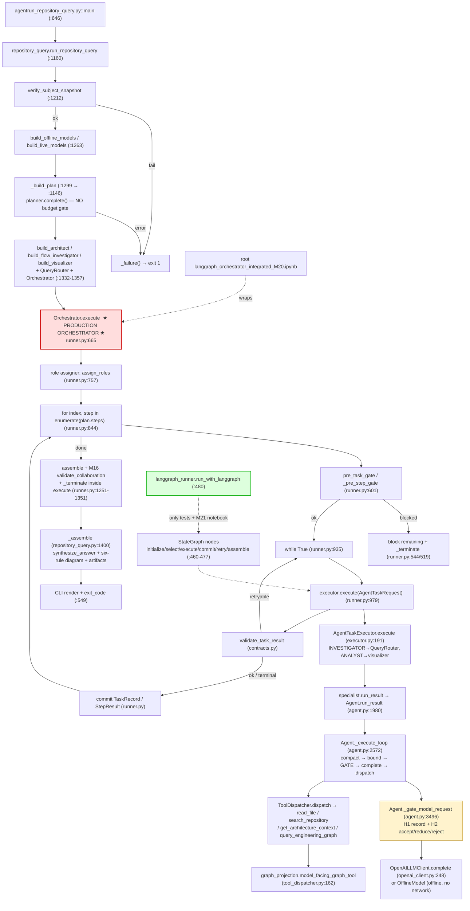
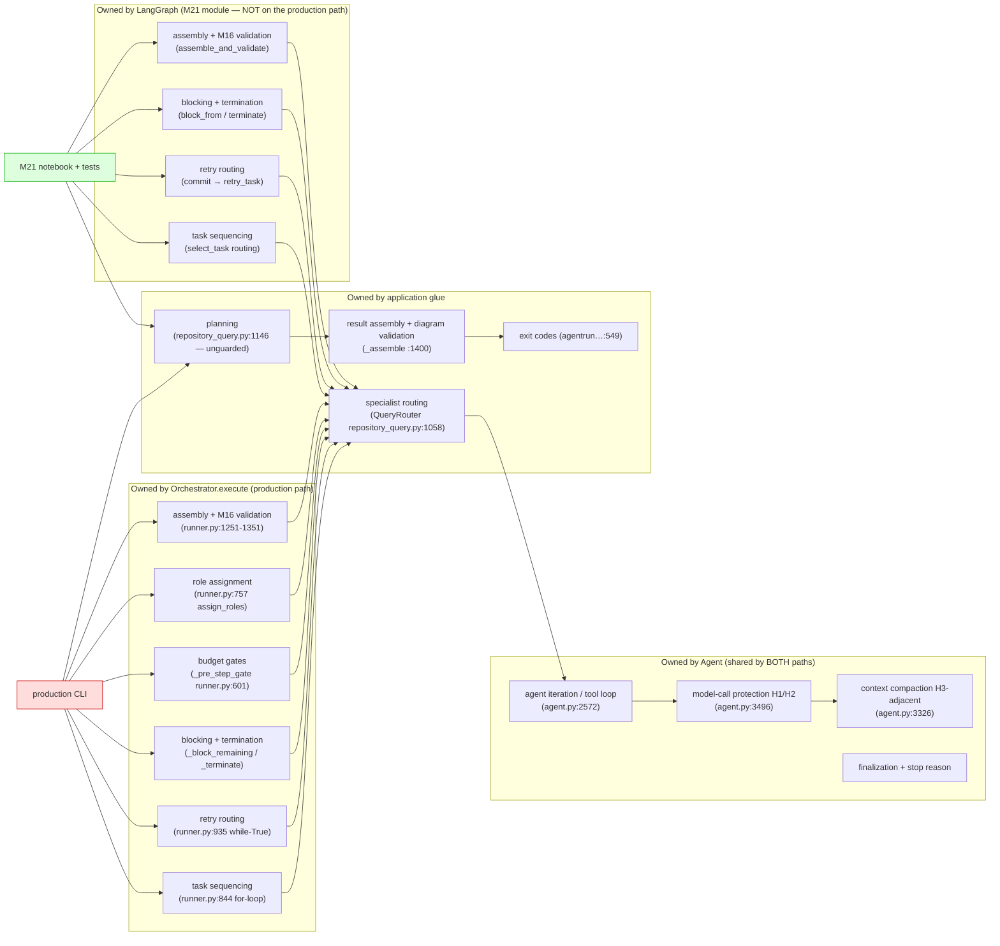

# Audit — Actual Execution Path and LangGraph Migration Boundary

**Scope:** read-only audit and migration plan. No application code was modified.
**Date of audit:** 2026-10-18. **Line numbers** refer to this checkout as audited.

---

## 1. Executive Summary

The application has **three coexisting execution paths** and only one of them is
reached by the documented front door.

1. **Production path (verified):** `agentrun_repository_query.py` →
   `run_repository_query()` → **`Orchestrator.execute()`**
   (`src/repo_intelligence/orchestration/runner.py:665`) — a hand-written
   Python `for` loop (`:844`) with an inner retry `while True` (`:935`).
   LangGraph is **not imported at all** on this path. Verified at runtime: the
   full offline query completed (exit 0) with a `meta_path` hook that raises on
   every `langgraph` import — **zero attempts recorded**.
2. **M21 LangGraph path (verified, test/notebook only):**
   `orchestration/langgraph_runner.py` compiles a real `StateGraph`
   (`:460-477`) that owns select → execute → commit → retry → assemble/validate
   and never calls `Orchestrator.execute`. It is invoked **only** by
   `run_with_langgraph()` (`:480`), whose only call sites are
   `tests/orchestration/test_langgraph_sequential.py` (34 tests, all passing)
   and `src/repo_intelligence/langgraph/langgraph_orchestrator_integrated_M20.ipynb`.
3. **Competing notebook path (verified):** the root-level
   `langgraph_orchestrator_integrated_M20.ipynb` (same filename, *different*
   content, `langgraph_orchestrator_integrated_M20.ipynb:14,455`) explicitly
   states *"The repository's `Orchestrator.execute(...)` remains the owner of
   the task lifecycle"* — a graph that **wraps** the monolithic executor.
   `langgraph_orchestrator_integrated.ipynb` and `graph_validation.ipynb` do
   the same.

**Architecture classification: D — multiple competing execution paths exist**
(Section 5). Within the M21 module the graph genuinely owns orchestration
(would be *A* in isolation); the production entry point uses *no* LangGraph
(the legacy orchestrator alone would be its own class); two notebooks are *C*.

**H1–H4 are integrated at the Agent model-call seam** (`Agent._gate_model_request`,
`agent/agent.py:3496`), which sits **below both orchestration layers** — so they
protect model calls on *both* the legacy and the LangGraph paths, applied once
per provider call. **One active model-call path bypasses them:** the planner
call in `run_repository_query._build_plan` (`repository_query.py:1146-1150`),
demonstrated at runtime: a 400,851-char request (100,522 estimated tokens vs a
95,232 budget) was handed to the provider client with no gate; the same request
would be `rejected` by the Agent gate.

**Single most important gap:** the documented front door never invokes the
graph, so LangGraph owns none of the production workflow's task sequencing,
retry, blocking, or termination.

**Smallest next task (not implemented here):** add an explicit, opt-in
`orchestration="langgraph"` seam in `run_repository_query` that preassigns roles
with the existing `assign_roles()` and delegates the task loop to
`run_with_langgraph()` — lazy import, contracts/assembly/validation untouched —
plus a canonical-path test and a legacy/graph parity test (Section 11).

**Verification actually run in this audit:**

| Command | Result |
|---|---|
| `venv312/bin/python -m pytest tests/ -q` | **2407 passed, 2 skipped** in 38.88s |
| `... -q -rs` (skip reasons) | `RUN_OPENAI_SMOKE` opt-in; `Graphviz dot not installed` |
| `venv312/bin/python -m pytest tests/orchestration/test_langgraph_sequential.py -q` | **34 passed** |
| `venv312/bin/python -m pytest tests/agent/test_request_budget.py -q` | **35 passed** |
| `venv312/bin/python -m pytest tests/agent/test_context_budget_lifecycle.py -q` | **6 passed** |
| `venv312/bin/python -m pytest tests/tools/test_graph_projection.py -q` | **22 passed** |
| `venv312/bin/python -m pytest tests/agent/test_agent_graph_tool.py -q` | **8 passed** |
| `venv312/bin/python -m pytest tests/agents/test_repository_query.py -q` | **51 passed** |
| `venv312/bin/python agentrun_repository_query.py "How do the agents, tools, and MCP servers interact?" --verbose` | `Status COMPLETED`, **exit 0** |
| same query through a `langgraph`-blocking `meta_path` probe | **exit 0, `[]` langgraph imports attempted** |
| `_build_plan` with a 400,851-char question against a probe client | request **sent**, `within_budget=False` (100,522 > 95,232) |

No live (`--live`) run was performed: `OPENAI_API_KEY` is absent and there is
no `.env` in this environment. Live behavior is **Unknown**, not claimed.

---

## 2. Repository and Runtime Identity

| Item | Value |
|---|---|
| Repository root | `/home/FRACTAL/nilesh.pandey/repository-intelligence` |
| Git | **Not a git repository** (`git rev-parse --is-inside-work-tree` → `fatal: not a git repository`). No branch/commit/worktree status available. Audited by filesystem state only. |
| Package | `src/repo_intelligence` (installed editable into `venv312`), `pyproject.toml` v0.3.0, `requires-python >=3.10` |
| Interpreter | `venv312/bin/python` → **Python 3.12.3** |
| Key deps | `langgraph 1.2.15`, `langchain-core 1.6.11`, `langgraph-checkpoint 4.3.0`, `langgraph-prebuilt 1.1.1`, `openai 1.99.1`, `pydantic 2.10.6`, `pytest 8.4.2`, `networkx 3.5`, `numpy 2.5.4`, `faiss-cpu 1.15.1`, `jsonschema 4.25.1` |
| LangGraph declaration | optional extra `graph = ["langgraph>=1.0"]` (`pyproject.toml`), pinned `langgraph==1.2.15` (`requirements.txt`) — core package imports without it |
| Other venv | `.venv` (Python 3.7, pyenv) — **not used, untouched** |
| Model provider | **OpenAI only.** `llm/openai_client.py:48 OpenAILLMClient`, `DEFAULT_MODEL = "gpt-4o-mini"` (`:43`), behind the provider-neutral `LLMClient` Protocol (`llm/client.py:78`). No Anthropic/Azure/Bedrock adapters exist. |
| Live config | `OPENAI_API_KEY` **absent**, no `.env` → `--live` cannot be exercised here |

### Entry points inspected

| Entry point | What it runs | Status |
|---|---|---|
| `agentrun_repository_query.py` (CLI, offline default; `--live`, `--verbose`, `--repository`, `--no-artifacts`, `--no-diagram`) | `run_repository_query` → **`Orchestrator.execute`** | **Production / front door** (README:1538 “the front door over the whole stack”) |
| `repo-intelligence` console script / `python -m repo_intelligence.cli` (`cli.py:519 main`) | subcommands `snapshot, facts, model, architecture, diagram, context, retrieval-index` — **no query subcommand** | Production, but not a query path |
| `python -m repo_intelligence.agent` (`agent/__main__.py:170 agent.run`) | single-agent smoke run | Alternate |
| `agentrun_m10..m19_*.py`, investigator/visualization demos | `Agent.run_planned` / `Orchestrator.execute` | Legacy/demo |
| `tests/orchestration/test_langgraph_sequential.py` | `run_with_langgraph` | **Only automated LangGraph path** |
| `src/repo_intelligence/langgraph/langgraph_orchestrator_integrated_M20.ipynb` | outer graph → nested `build_langgraph_orchestration_graph(orchestrator)` | LangGraph-owned notebook path (documented by `docs/m21-langgraph-orchestration.md:207`) |
| `langgraph_orchestrator_integrated_M20.ipynb` (root, same name, **different bytes**) | outer graph → `orchestrator_node` → **`orchestrator.execute`** | **Competing notebook path** (undocumented) |
| `src/repo_intelligence/langgraph/langgraph_orchestrator_integrated.ipynb`, `graph_validation.ipynb` | `orchestrator.execute` | Competing/legacy notebooks (undocumented) |
| `src/repo_intelligence/langgraph/graph_run.py`, `langgraph/planner.py` | standalone demos; hard-coded `PROJECT_ROOT = Path("C:/self-study/ai/build/repository-intelligence/")` | **Dead / unreferenced** (importers: none in `src/` or `tests/`; only each other and the notebooks) |

### LangGraph-specific tests

`tests/orchestration/test_langgraph_sequential.py` — 34 tests, `importorskip`
guarded, all passing. Includes `test_graph_path_never_calls_monolithic_execute`
and `test_langgraph_runner_source_has_no_monolithic_dispatch_call`
(`:1117`) which assert the graph never delegates to `Orchestrator.execute`.

---

## 3. Actual End-to-End Execution Path

Representative path: `python agentrun_repository_query.py "<question>"` (offline,
the default), traced to the printed answer. **Runtime status legend:**
**A** = confirmed active on the production path · **Alt** = active on another
path · **Dead** = unreferenced · **U** = unknown.

| Stage | Responsibility | Source location | Caller | Status | State owner | Control-flow owner | Error behavior | Evidence |
|---|---|---|---|---|---|---|---|---|
| 1. Query ingestion | argparse → `main` → `_run_once` | `agentrun_repository_query.py:646, 514` | `__main__` | A | `argparse.Namespace` | CLI | usage errors → exit 2; `KeyboardInterrupt` → 130 | read + run (exit 0) |
| 2. Request setup | strip/validate question; resolve + **verify pinned snapshot**; `load_env()`; build model set | `repository_query.py:1187-1296` | `run_repository_query` (`:1160`) | A | local vars | `run_repository_query` | `_failure(...)` with `SNAPSHOT_VERIFICATION_FAILED` / `NO_TARGET` / `LIVE_CONFIGURATION_UNAVAILABLE` / `MODEL_SET_FAILED` → exit 1 | read (`:1211-1296`) |
| 3. Planning | `planner.complete(build_planning_request(q))` → `plan_from_response` → `validate_plan` | `repository_query.py:1146-1150`, called `:1299` | `run_repository_query` | A | returned `InvestigationPlan` | `run_repository_query` | `_PLAN_ERRORS` → `PLAN_FAILED`, exit 1. **No H1/H2 gate on this call** | read + runtime probe (Section 6) |
| 4. Role assignment | `assign_roles(plan.steps)` via `self._role_assigner` | `runner.py:757`, `roles.py:104` | `Orchestrator.execute` | A | `plan.steps` + assignments list | **`Orchestrator.execute`** | `ValueError` before any agent runs | read (`:752-757`) |
| 5. Orchestration entry | `orchestrator.execute(TaskPayload, plan)` | `repository_query.py:1352-1365` → `runner.py:665` | `run_repository_query` | A | `OrchestrationRun` (`run.tasks/step_results/events`) | **`Orchestrator.execute`** | always returns terminal record; `ContractError` only for malformed emits | read + runtime probe (langgraph never imported) |
| 6. LangGraph compile/invoke | `build_langgraph_orchestration_graph(...).compile()` / `run_with_langgraph` | `langgraph_runner.py:119, 477, 480` | tests + M21 notebook only | **Alt (not on production path)** | graph channels | — | clear `ImportError` if extra missing | read (no `src/` importer) + probe `[]` |
| 7. Graph nodes/edges | `initialize / select_task / execute_task / commit_result / retry_task / assemble_and_validate` + 5 conditional edges | `langgraph_runner.py:460-477` | `run_with_langgraph` | Alt | `LangGraphOrchestrationState` (`:86`) | **the graph** | typed terminal routing via `terminate()` | read |
| 8a. Custom orchestration loop | plan-step `for` loop + per-step retry `while True` | `runner.py:844`, `:935` | `Orchestrator.execute` | A | `run` (mutated only by coordinator) | **`Orchestrator.execute`** | `fail_step` → block successors → `_terminate` | read |
| 8b. Executor dispatch | `AgentTaskRequest` → participant `run_result` → `AgentTaskResult` | `executor.py:191-244` (registry `:198`, call `:212-218`) | `runner.py:979` / `langgraph_runner.py:262` | A (both paths) | returns immutable result; never touches `run` | caller | exception → `classify_exception` → typed failed result | read |
| 8c. Agent reasoning loop | one bounded ReAct/tool loop per task: compaction → bound → **gate** → `complete` → dispatch → repeat | `agent.py:2572 _execute_loop` | `Agent.run_result` (`:1980`) via specialist wrappers | A (both paths) | `AgentTrace` + `messages` list | **the agent loop owns tool iteration, budget, finalization** — not cross-task sequencing | `AgentError` with termination reason; trace finalized in `finally` | read + runtime (`trace.json`) |
| 9. Model invocation | `self._llm_client.complete(final_request)` | `agent.py:2786` (loop), `:2397` (agent plan), `:3787` (finalize) | `_execute_loop` / `_create_plan` / `_finalize_run` | A | — | agent | `LLMError`; context overflow correlated onto the budget record | read + runtime (`request_budget` × 4 in `trace.json`) |
| 10. Tool dispatch | `ToolCall` → registry → `ToolResult`; 4 read-only tools | `tool_dispatcher.py:155-166`, boundary `:1-30` doc | agent loop | A | `trace.iterations[].tool_results` | dispatcher never loops/retries | unknown name / malformed → structured `ToolResult` failure | read |
| 11. Message/history accumulation | chronological `messages`; persistent compaction then per-request bound | `agent.py:3326 _compact_working_context`, `:3413 _bound_working_context` | `_execute_loop` | A | `messages` | agent | compaction declines (never grows) when it cannot shrink | read + tests (`test_context_compaction.py`, 15 tests pass) |
| 12. Context budgeting | H1 record + H2 accept/reduce/reject **before** provider | `agent.py:3496 _gate_model_request` → `request_budget.py:439 enforce_request_budget` | all three model-call sites | A (both paths) | `AgentIteration.request_budget` | agent | reject → `AgentError(CONTEXT_BUDGET_EXCEEDED)` / `FINALIZATION_FAILED`; never retried unchanged | read + runtime record (Section 6) |
| 13. Evidence collection | `enforce_inspected_evidence` (removal-only) + `gather_evidence`; trace persisted per agent run | `architecture_investigator.py:88 run_result`; `JsonFileTraceSink` → `runtime/agent_runs/<id>/trace.json` | specialist `run_result` | A | `AgentTrace` + `ReportEvidenceRef` on outputs | specialist | unread-backed findings stripped → status `incomplete` | read + runtime (`trace.json` 307 KB) |
| 14. Analysis / synthesis | merged report (`RunAssembler.merge_reports`) → analyst `DiagramSpec` → `synthesize_answer` | `assembly.py`; `offline_investigation.py:1348` | orchestrator loop / `_assemble` | A | `run.report`, `run.finding` | orchestrator then `_assemble` | missing report → `RuntimeError` (unreachable by post-condition) | read |
| 15a. Assembly + M16 verdict | `assembler.assemble` → `validate_collaboration` → `_terminate(SUCCESS/…)` **inside the driver** | `runner.py:1251-1351` (legacy) / `langgraph_runner.py:426-458` (graph) | `Orchestrator.execute` / graph `assemble_and_validate` | A (both) | `run.report`, `run.finding`, `run.validation` | the active driver | `VALIDATION_FAILED` / `DECLARED_INCOMPLETE` / `NO_ANALYSIS` | read + run (`collaboration: passed`) |
| 15b. Result rendering assembly + diagram validation + artifacts | build `RepositoryQueryResult`, six-rule `validate_diagram_spec`, write artifacts | `repository_query.py:1400 _assemble` (`:1539` validate, `:1557` write) | `run_repository_query` `:1380` | A | `RepositoryQueryResult` | **`_assemble` — post-orchestration, outside both loops** | failures appended to `result.failures` | read + run (artifacts written) |
| 16. Output / exit code | `_print_result`, `exit_code(result)` | `agentrun_repository_query.py:549, 300` | `_run_once` | A | — | CLI | 0 / 1 / 2 / 3 | run: `exit code: 0` |

**Key structural observations**

- Stages 4, 5, 8a, **15a** and the retry/block/terminate decisions are owned by
  `Orchestrator.execute` — a single ~686-line method (`runner.py:665-1351`).
- Stage 15b (`_assemble`) is **outside** both orchestration implementations and
  reads participant-side state (`architect.last_trace`,
  `flow_investigator.last_trace`, `visualizer.last_spec` —
  `repository_query.py:1524-1537`), not just the `OrchestrationRun`. Any graph
  migration must keep those participant references reachable.
- `QueryRouter.run_result` (`repository_query.py:1058`) is the glue that maps a
  step label/goal to a specialist; the orchestrator and the graph both know
  nothing about it.

---

## 4. Execution and Control-Ownership Diagrams

### Diagram 1 — Actual execution path (as observed)

Solid arrows = the observed production path. Dashed arrows = paths that exist
but are **not** reached by `agentrun_repository_query.py`.

### Diagram 2 — Control ownership

**Why they differ:** the two diagrams are *not* identical. Two orchestration
layers implement the same task lifecycle twice — `Orchestrator.execute`
(`runner.py:665-1351`) and the graph nodes (`langgraph_runner.py:172-477`) —
with deliberate parity (cross-path test
`test_budgeted_router_scenario_is_compatible_across_both_paths`,
`test_langgraph_sequential.py:1217`). Only the legacy layer is reachable from
the front door; only the graph layer is reachable from the M21 notebook and the
test suite. The duplicated control flow is exactly the migration target.

---

## 5. LangGraph Orchestration Assessment

Answers to the ten questions, with evidence.

| # | Question | Answer | Evidence |
|---|---|---|---|
| 1 | Is the graph compiled and invoked by the intended entry point? | **No** for the production entry point. Yes for the M21 notebook and the test suite. | Compile: `langgraph_runner.py:477`; invoke: `:480-485`; only call sites `tests/orchestration/test_langgraph_sequential.py` + `src/repo_intelligence/langgraph/langgraph_orchestrator_integrated_M20.ipynb` cell 20/22. Production: `repository_query.py:1358 orchestrator.execute(...)`. **Runtime probe:** full CLI run with `langgraph` imports blocked → exit 0, `[]` attempts. |
| 2 | Does the graph represent the actual task lifecycle, or delegate it? | **Represents it.** Nodes own plan gate, selection, attempts, retry, commit, block, assembly, validation; `runtime.execute` is never referenced (`langgraph_runner.py:122` docstring; source-scan test `test_langgraph_sequential.py:1117`). | `langgraph_runner.py:172-458` |
| 3 | Does graph state contain plan, current task, results, evidence, failures, status? | **Yes, but mostly nested inside one mutable `run` object.** Channels: `task, plan, role_assignments, run, task_index, attempt, current_*`, routing fields (`:86-116`). Task results/evidence/failures live on `run.tasks` / `run.step_results` / `run.failures` (`models.py:97-140` carries `output`, `evidence_refs`, `failure_category`, `agent_run_id`, `usage_total`). | `langgraph_runner.py:86-116`; `models.py:97-140` |
| 4 | Are graph nodes bounded units, or hidden multi-step loops? | **Bounded units.** The only loop nested inside a node is the *agent* loop reached through `execute_task → executor.execute → Agent._execute_loop` — legitimate per-task reasoning, not cross-task sequencing. | `langgraph_runner.py:261-269` |
| 5 | Does a custom `Orchestrator.execute(...)` independently decide the complete workflow? | **Yes — on the production path.** Plan gate, roles, step order, retries, blocking, budgets, termination are all decided there. | `runner.py:665-1351` (`for` `:844`, `while` `:935`, gates `:601`) |
| 6 | Are agent-level loops nested inside graph nodes? What do they own? | Yes: tool iteration, working-context compaction, request budget gate, stop/finalize decisions. They do **not** sequence planned tasks. `Agent.run_planned` (`agent.py:2149`) *does* sequence plan steps inside one agent (M10) but is **not** on either orchestration path — only demos/tests (`agentrun_m10/m13/m14/m15`, `tests/agent/*`). | `agent.py:2572-3326`; caller grep |
| 7 | Transitions via graph edges or Python branching? | **Both exist:** graph conditional edges (`langgraph_runner.py:467-476`) on the M21 path; ordinary `for`/`while`/`if` (`runner.py:844`, `:935`, result handling from `:1043`, retry gate `:1157`) on the production path. | read |
| 8 | Does the graph own continue/block/retry/fail/terminate? | **On the graph path, yes** (`select_task` gate `:212-221`, `commit_result` retry `:358-402`, `terminate` `:135-145`). **On the production path, no** — `Orchestrator._pre_step_gate` / `_terminate` do. | read |
| 9 | Are task status, trace IDs, errors, tool-call metrics propagated end to end? | **Yes on both paths**, with a deliberate parity test. `TaskRecord.status/attempts/agent_run_id/usage_total/error` flow from `AgentTaskResult` to run records; events unchanged (`ORCHESTRATION_OPERATIONS` is test-pinned). | `executor.py:229-244`; `runner.py:1013-1029`; `langgraph_runner.py:286-323`; parity test `:1217-1259` |
| 10 | Clear boundary between domain logic and orchestration? | **Partially.** Clean: `AgentTaskExecutor`/contracts/tools/validator are domain. Unclear: **two orchestration implementations coexist** and four notebooks expose different combinations of them. | Section 3 diagram |

### Classification: **D — multiple competing execution paths exist**

Sub-descriptions (the prompt permits hybrids):

- **Production CLI path:** legacy orchestrator is sole owner; LangGraph absent
  (would classify as *no LangGraph* — the legacy loop is the control owner).
- **M21 LangGraph module + notebook:** genuine graph ownership — **A** in
  isolation. Verified by 34 behavioral tests and the two “never
  `Orchestrator.execute`” guards.
- **Root `langgraph_orchestrator_integrated_M20.ipynb`,
  `langgraph_orchestrator_integrated.ipynb`, `graph_validation.ipynb`:** graph
  wrapping the monolithic executor — **C**, and the root notebook says so
  explicitly (`langgraph_orchestrator_integrated_M20.ipynb:14`).

**What prevents the desired architecture (exact remaining control-flow
ownership):**

1. `Orchestrator.execute` (`runner.py:665`) still owns task sequencing, role
   assignment, retries, budgets and termination for every user-facing query.
2. `run_with_langgraph` has **no production call site** — the graph is a
   library with tests, not a workflow.
3. `_assemble` (`repository_query.py:1400`) — final answer synthesis,
   diagram validation, artifact writing, exit-code inputs — sits outside both
   loops, so even the graph path cannot produce a user-visible result without
   going through the legacy assembly seam.
4. Four notebooks document three different ownership stories under two
   identical filenames.

---

## 6. H1–H4 Integration and Context-Safety Audit

**Mandatory distinction — where do the protections run?**
**(3) Both.** H1/H2/H3 live *below* both orchestration layers:

- H1/H2 at `Agent._gate_model_request` (`agent.py:3496`), called before
  `self._llm_client.complete` at **all three** agent model-call sites
  (`:2346`, `:2699`, `:3730` gates → `:2397`, `:2786`, `:3787` sends).
- The graph reaches that seam through the *same*
  `AgentTaskExecutor.execute` → `participant.run_result` → `Agent.run_result`
  chain (`executor.py:212-218`), so **each model call is protected exactly
  once** on either orchestration path (no double gating, no gap).
- **Exception:** model calls that never enter an `Agent` are unprotected —
  the planner (below).

### Integration matrix

| Component | Source | Verified call sites | Applies to legacy path | Applies to LangGraph path | Test coverage (ran) | Gap |
|---|---|---|---|---|---|---|
| **H1 request diagnostics** | `request_budget.py:260 build_request_budget_record`; attached `agent.py:3522 record["run_id"], ["model"]` | 3 gate sites (above); record persisted as `AgentIteration.request_budget` | Yes | Yes | `test_request_budget.py` **35 passed** (`test_record_measures_the_whole_request_not_only_messages`, `test_record_captures_roles_largest_messages_and_budget`, `test_record_carries_no_message_content`); `test_context_budget_lifecycle.py` **6 passed**; runtime: 4/4 iterations of a real offline run carry records | Covers messages + **tool definitions (2,719 chars)** + **structured-output schema (4,798 chars)** + budget/out reservation. **No `task_id` / orchestration `run_id` / graph-node name on the record** — correlation to a task is only possible by joining `record.run_id` → `TaskRecord.agent_run_id`. Planner calls outside `Agent` produce **no record at all**. |
| **H2 request budgeting** | `request_budget.py:439 enforce_request_budget`; `agent.py:3496 _gate_model_request`; config `AgentExecutionConfig.max_request_input_tokens` | immediately **before** every provider `complete` in `Agent` | Yes | Yes | 35 + 6 passed, incl. `test_rejected_request_is_never_sent_and_fails_typed`, `test_over_budget_tool_observations_clip_to_valid_envelopes`, `test_protected_content_over_budget_rejects_and_returns_original`, `test_tool_schema_contract_over_budget_is_named`, `test_planner_request_is_gated_before_any_provider_call` | **Bypass verified:** `run_repository_query._build_plan` (`:1146-1150`) and the M21 notebook `planner_node` call `planner.complete(...)` with no gate. Runtime proof: 400,851-char question → 100,522 tokens-est sent, `within_budget=False`. `langgraph/planner.py:156` also ungated (dead demo). Budget is an **estimate**, not a provider limit: `CHARS_PER_TOKEN = 4` (`request_budget.py:61`), default `128,000 − 16,384 − 16,384 = 95,232` (`:71-75`) — documented as `is_estimate: true` in the record. Compaction failure → typed `AgentError(CONTEXT_BUDGET_EXCEEDED)` / `FINALIZATION_FAILED`, request never retried unchanged (tests above). |
| **H3 graph-result compaction** | `tools/graph_projection.py:262 project_graph_result_for_model`, `:347 model_facing_graph_result`, `:385 model_facing_graph_tool`; `DEFAULT_MODEL_GRAPH_MAX_BYTES = 24_000` (`:60`) | `tool_dispatcher.py:162` (`tool_registry()` → default dispatcher) **and** `repository_query.py:778` (`live_bindings.graph`) | Yes (both bindings are on the production path) | Yes (same registry) | `tests/tools/test_graph_projection.py` **22 passed** — dedup (`test_evidence_is_deduplicated_into_one_referenced_table`), explicit `payload.truncated`, deterministic drop order (deepest first, start node kept), `MODEL_PAYLOAD_TOO_LARGE` structured failure, re-projection resolvable, pinned-hub-fits test | **Before** results enter the next model context (tool boundary, not model boundary). Evidence preserved by reference: one `ev:sha256` table, entities carry `evidence_ids` (`graph_projection.py:96-194`); refinement hint tells the model how to re-query (`:63`). Bounded on **every registered path**. **Not exercised in offline mode** — `fixture_bindings` returns a canned empty graph result (`repository_query.py:672-688`), so the projection is bypassed there (harmless: payload is empty). `read_file`/`search_repository`/`get_architecture_context` are bounded by their own limits (`MAX_FILE_BYTES`, `DEFAULT_MAX_RESULTS = 5`), backstopped by H2. |
| **H4 regression tests** | see below | — | partial | partial | Full suite **2407 passed, 2 skipped** (skips: `RUN_OPENAI_SMOKE` opt-in, Graphviz absent) | see gaps below |

### H4 detailed gap analysis

| Requirement | Status | Evidence |
|---|---|---|
| Tests exercise the actual request-budget lifecycle | **Yes, at agent level** | `test_context_budget_lifecycle.test_every_model_call_of_a_planned_run_carries_a_record` (6 passed) |
| Tests exercise the **graph's real model-call boundary** | **Exercised, never asserted** | The 34 graph tests build **real** `Agent`s (`m17_doubles.py:176,186`) so `_gate_model_request` runs — but all requests are far under budget and no test asserts a budget outcome there |
| Large tool observations across **successive** model calls | **Yes at agent level, no graph variant** | `test_over_budget_observation_is_clipped_before_the_provider` (single), `test_context_compaction.test_repeated_compaction_keeps_every_request_bounded` (successive) |
| Oversized structured schemas / tool definitions represented | **Yes at record/gate level** | `test_record_measures_the_whole_request_not_only_messages`, `test_tool_schema_contract_over_budget_is_named` |
| Diagnostics tested for privacy | **Yes** | `test_record_carries_no_message_content`, `test_provider_overflow_diagnostics_never_embed_request_content` |
| Graph integration + failure propagation covered | **Yes for orchestration, no for context** | 34 graph tests cover retry/blocked/contract/budget-of-tool-calls; **no test file contains both `langgraph` and `request_budget`/`max_request_input_tokens`** (grep-verified) |
| CLI planner gate covered | **No** | `test_planner_request_is_gated_before_any_provider_call` targets `Agent.run_planned`, not `run_repository_query._build_plan` |
| Live provider covered | **Not runnable here** | no key; `RUN_OPENAI_SMOKE` skipped |

### H1 diagnostic correlation (precise)

Observed record on a real offline run (`runtime/agent_runs/ff7d9000…/trace.json`):
`run_id` = agent trace id, `model: "offline-scripted"`, per-message
characters/token-estimates (no content), `tool_definitions{count:4, characters:2719}`,
`structured_output{name:"ArchitectureReport", characters:4798}`,
`totals.total_tokens_est: 4078`, `budget.effective_input_budget_tokens: 95232`,
`disposition: "accepted"`, `estimation.method: "chars_per_token_estimate"`.
The record carries **no orchestration run id, no task id, no graph node**.

### Before H5

- Current budget implementation runs **inside `Agent`, per model call**, on
  both orchestration paths, plus **nowhere else**.
- Supported provider: **OpenAI only**, default `gpt-4o-mini`
  (`llm/openai_client.py:43`), capacity assumption 128,000
  (`request_budget.py:75`). Any H5 must first decide whether to keep the
  char-ratio estimate for other models — **out of scope for this audit.**

---

## 7. Migration Boundary

The smallest defensible boundary: **make `run_repository_query` delegate the
task loop to the already-existing graph driver, and leave everything else
alone.** The graph module (`langgraph_runner.py`) already implements
Boundaries 2, 3 (task level) and 6; no new orchestration code is required.

| Responsibility | Recommended owner | What must be preserved |
|---|---|---|
| Workflow sequencing | **LangGraph** (`langgraph_runner` nodes) | existing plan order, `sequential_dependencies`, `ready_tasks` readiness gate |
| Task and run state | **existing `OrchestrationRun`/`TaskRecord` carried in graph state** (do not fork a new state model) | `TASK_*` vocabulary, `usage` vs `usage_total`, `failure_category`, `agent_run_id` |
| Agent reasoning | Agent component invoked by `execute_task` (unchanged) | role prompts, structured-output contracts, M13 evidence acceptance |
| Model request protection | **shared `Agent._gate_model_request`** (unchanged) + close the planner bypass | H1 records, H2 dispositions, H3 projection |
| Repository tools | existing `ToolDispatcher` + bindings (unchanged) | 4-tool registry, role allowlist, `model_graph_compact.v1` |
| Evidence storage | existing `JsonFileTraceSink` + `ReportEvidenceRef` (unchanged) | claim → EvidenceRef → artifact → pinned commit |
| Failure routing | **graph transitions** (already) + existing `TaskFailure` taxonomy | failed/blocked/completed/`termination_reason` semantics |
| Final report | **keep `_assemble` where it is** for this phase | `RepositoryQueryResult`, exit codes, artifact bytes |

### The six requested boundaries

**Boundary 1 — Graph entry point.**
*Remains unchanged:* all of `run_repository_query`'s front half (question
validation, snapshot verification, model-set construction, `_build_plan`,
composition of specialists).
*Moves into a graph node/edge:* nothing new — the graph already exists; what
is added is a **call** to `run_with_langgraph(...)` in place of
`orchestrator.execute(...)` (`repository_query.py:1358`), behind an explicit
`orchestration=` parameter.
*Explicit graph state:* `task`, `plan`, `role_assignments` — already declared
(`langgraph_runner.py:93-95`).
*Must no longer control orchestration outside the graph:* the `for`/`while`
loops in `runner.py` — **but only on the opted-in path**, first.
*Public interfaces that must stay compatible:* `run_repository_query(...)`
signature and `RepositoryQueryResult` fields; `Orchestrator.execute(task, plan,
role_overrides=None, role_assignments=None)` for the retained legacy path;
`AgentTaskRequest`/`AgentTaskResult`.
*Tests for behavioral equivalence:* existing `tests/agents/test_repository_query.py`
(**51 passed**) + new parity test (Section 9, T1/T9).
*Practical constraint:* the import of `langgraph_runner` must be **lazy**
(inside the graph branch) so the core package still imports without the
optional `graph` extra, as `pyproject.toml` promises. Role assignment must be
done before invocation with `assign_roles(plan.steps)` (`roles.py:104`) — the
CLI passes no overrides today (`runner.py:757` calls exactly that), so it is
byte-equivalent.

**Boundary 2 — Task lifecycle.**
*Remains unchanged:* `TaskRecord`, `TASK_*` statuses, `ready_tasks`,
`sequential_dependencies`.
*Moves into the graph:* already there — `initialize` creates records
(`langgraph_runner.py:199-201`), `select_task` gates readiness (`:242-246`),
`commit_result` commits (`:310-327`), `block_from` blocks (`:147-170`).
*Explicit graph state:* `task_index`, `attempt`, `current_*`, `terminal`.
*Must no longer own transitions outside the graph:* `Orchestrator.execute`'s
loop **on the graph path** (it keeps ownership on the legacy path until Phase 6).
*Compatible interfaces:* `OrchestrationRun` shape, `run.events` operation
vocabulary (test-pinned by `ORCHESTRATION_OPERATIONS`).
*Equivalence tests:* `test_langgraph_sequential.py` (34) +
`test_m17_runner.py`, `test_m19_runner_tasks.py`, `test_m20_lifecycle.py`.

**Boundary 3 — Agent execution.**
*Remains unchanged:* `Agent._execute_loop` — it owns tool iteration,
compaction, budget, finalization **for one task**. It never sequences planned
tasks on either active path, so it does **not** need migrating now.
*Nested loop to identify and fence off:* `Agent.run_planned` (`agent.py:2149`)
sequences plan steps inside a single agent (M10). It is **not reachable** from
`run_repository_query` (caller grep: only `agentrun_m10/m13/m14/m15*.py` and
`tests/agent/*`). **Decision: leave it, document it as a demo-only legacy
path.** It must not be re-introduced into the graph path.
*Boundary to document explicitly:* “the graph sequences *tasks*; the agent
loops over *tool calls within a task*.”

**Boundary 4 — Context safety.**
*Remains unchanged:* `Agent._gate_model_request` as the single protection
seam (already on the graph path through the executor).
*Moves/changes:* gate the **planner** call. Smallest fix: wrap
`_build_plan`'s `planner.complete(...)` with `enforce_request_budget(...)`
(reusing `request_budget.py:439`) so `repository_query.py:1147` becomes
gate-then-send. Same for the notebook `planner_node` if it is retained.
*Must no longer bypass:* any direct `LLMClient.complete` outside `Agent`.
*Compatible interfaces:* `build_planning_request`/`plan_from_response`
untouched; rejection produces the existing `_PLAN_ERRORS` → `PLAN_FAILED` path.
*Equivalence tests:* extend `tests/agents/test_repository_query.py` (51) with a
planner-gate test mirroring `test_planner_request_is_gated_before_any_provider_call`.

**Boundary 5 — Results and evidence.**
*Remains unchanged:* `_assemble`, `synthesize_answer`, `validate_diagram_spec`,
`write_visualization_artifacts`, `ReportEvidenceRef`, `enforce_inspected_evidence`,
`model_graph_compact.v1`.
*Moves into graph state:* nothing — deliberately. The graph already carries
`run.report` / `run.finding` / `task_record.evidence_refs`; do **not** copy
repository graphs or file contents into shared state (H3 already bounds graph
observations to 24,000 bytes).
*Must no longer happen:* large payloads entering conversational state —
currently respected (compaction + projection + read_file limits).
*Tests:* `tests/tools/test_graph_projection.py` (22),
`tests/agents/test_investigator_evidence_acceptance.py`, M13 evidence tests.

**Boundary 6 — Observability.**
*Remains unchanged:* `AgentTrace` + `JsonFileTraceSink`, `run.events`,
`TaskRecord.agent_run_id/usage/usage_total`, `run.agent_runs`.
*Changes:* H1 records should gain an orchestration join key (task id /
step id / orchestration run id) so diagnostics correlate without a two-hop
join — a small additive change to `build_request_budget_record`'s caller
(`agent.py:3522`), **not** a new subsystem.
*Must survive transitions:* already does (parity test
`test_budgeted_router_scenario_is_compatible_across_both_paths`); the graph
path also mirrors step events into per-step trace windows
(`langgraph_runner.py:309, 326, 354, 380`).
*Tests:* `test_m19_trace_attribution.py`, graph trace tests in
`test_langgraph_sequential.py`.

---

## 8. Incremental Migration Plan

Ordered by actual dependency. Phases 1–2 are one PR-sized change; nothing is
deleted until Phase 6.

### Phase 0 — Baseline (documentation only; no product code)

- **Objective:** make the audit reproducible as a guard.
- **Modules:** new `tests/orchestration/test_canonical_path.py` (asserts
  *current* reality: legacy is the production owner) + a short note in
  `docs/m21-langgraph-orchestration.md`.
- **Depends on:** nothing.
- **Contract preserved:** everything (tests only).
- **Focused tests:** one test that fails if `run_repository_query` silently
  changes orchestration owner without updating this baseline.
- **Acceptance:** full suite still 2407/2; baseline test documents
  `orchestrator.execute` as current production owner.
- **Risk/rollback:** delete the test file.
- **Out of scope:** any source change.

### Phase 1 — One orchestration entry point (opt-in)

- **Objective:** `run_repository_query` can delegate the task loop to the
  graph **without deleting** `Orchestrator.execute`.
- **Modules:** `src/repo_intelligence/repository_query.py` (add
  `orchestration: str = "legacy"` parameter; lazy import of
  `run_with_langgraph`; `assign_roles(plan.steps)` before invoking);
  `agentrun_repository_query.py` (add `--graph` flag, no other CLI change).
- **Depends on:** Phase 0.
- **Contract preserved:** default behavior byte-identical (`"legacy"`), so all
  51 `test_repository_query.py` tests and both demos stay green; same
  `RepositoryQueryResult`, same exit codes, same artifacts.
- **Focused tests:** T1 canonical-path, T10 legacy-path (Section 9),
  plus a parity test legacy-vs-graph on the same plan/roles.
- **Acceptance:** `--graph` offline run exits 0 with `collaboration: passed`
  and `diagram: passed`; probe proves `Orchestrator.execute` is **not** called
  under `--graph` and `langgraph` **is** imported; default run unchanged.
- **Risk/rollback:** optional extra missing → clear `ImportError` message;
  flip the parameter back to `"legacy"` (one line). Guard test
  `test_m17_repository_agnostic` inspects only `orchestration/` for framework
  imports and `repository_query.py` does not `import langgraph` directly —
  re-run it to confirm.
- **Out of scope:** deleting legacy, moving `_assemble`, planner gating,
  notebook cleanup.

### Phase 2 — Task control visible in graph state

- **Objective:** make the graph the *provable* owner of one bounded piece of
  sequencing that today is decided outside it: **role assignment**.
- **Modules:** `orchestration/langgraph_runner.py` (optional
  `assign_roles` node or an explicit pre-step in `initialize` when
  `role_assignments is None`), `repository_query.py` (stop pre-assigning).
- **Depends on:** Phase 1.
- **Contract preserved:** `assign_roles` output identical to
  `runner.py:757`; `_preassigned_role_assignments` validation still rejects
  bad input before any agent runs.
- **Focused tests:** role-assignment parity test; the 5 invalid-role
  `ValueError`-before-execution variants already in
  `test_langgraph_sequential.py`.
- **Acceptance:** graph-run role assignments == legacy-run role assignments
  for the standard 3-step offline plan (`S1/S2/S3`).
- **Risk/rollback:** keep `role_assignments=` accepting callers working (it
  already does — `langgraph_runner.py:197`).
- **Out of scope:** dynamic replanning, parallel steps.

### Phase 3 — Context protection on the real planner + graph path

- **Objective:** eliminate the one verified bypass; prove protection on the
  graph model-call path.
- **Modules:** `repository_query.py:_build_plan` (gate the request),
  optionally a tiny shared helper in `agent/request_budget.py`;
  `langgraph_orchestrator_integrated_M20.ipynb` `planner_node` if retained.
- **Depends on:** Phase 1 (so the graph path is reachable for testing).
- **Contract preserved:** H1 record shape, `PLAN_FAILED` failure taxonomy,
  provider-neutral request construction.
- **Focused tests:** T6, T7, T8 (Section 9).
- **Acceptance:** an oversized planning request never reaches the probe
  client and yields `PLAN_FAILED` / `CONTEXT_BUDGET_EXCEEDED`; an oversized
  tool observation inside a graph-run agent is clipped before `complete`.
- **Risk/rollback:** planner requests are small in practice — worst case is a
  rejected plan with a clear reason; revert the one call site.
- **Out of scope:** H5, tokenizer-based counting, provider-window catalogs.

### Phase 4 — End-to-end verification

- **Objective:** prove completed / failed / blocked outcomes and overflow
  prevention through the canonical entry point.
- **Modules:** tests only.
- **Depends on:** Phases 1–3.
- **Contract preserved:** exit codes 0/1/2/3, `termination_reason`
  vocabulary, artifacts bytes.
- **Focused tests:** T2–T8 + an offline CLI subprocess test asserting
  `Status COMPLETED` and exit 0 under `--graph`.
- **Acceptance:** full suite ≥ 2407 passed; `--graph` and legacy CLI runs
  both exit 0 offline; failure scenario yields `INCOMPLETE`/`AGENT_FAILED`
  with blocked successors.
- **Risk/rollback:** none (tests).
- **Out of scope:** live runs (no key in this environment).

### Phase 5 — Retire duplicate orchestration

- **Objective:** one documented owner; delete only what evidence shows is
  redundant.
- **Modules:** notebooks (reconcile the two identically-named M20 notebooks;
  mark `langgraph_orchestrator_integrated.ipynb`, `graph_validation.ipynb`,
  `graph_run.py`, `langgraph/planner.py` as archived or remove them),
  README/docs wording, and only then consider making `--graph` the default.
- **Depends on:** Phase 4 green.
- **Contract preserved:** `Orchestrator.execute` remains until every demo that
  uses it (`agentrun_m17`, `agentrun_m19`, three investigator demos) is either
  migrated or explicitly documented as legacy.
- **Focused tests:** guard tests updated deliberately (documented policy
  change, not silent weakening), as was done for `langgraph` in
  `test_m17_repository_agnostic.py`.
- **Acceptance:** exactly one documented canonical path; every remaining
  entry point either delegates to it or is labeled independent.
- **Risk/rollback:** keep legacy behind a flag for one more milestone.
- **Out of scope:** parallel execution, autonomous replanning, durable
  checkpoint/recovery, distributed execution — none is required by the
  current code.

---

## 9. Acceptance Test Matrix

“Existing” = passed in this audit (exact commands in Section 1).

| # | Test | Expected module | Status |
|---|---|---|---|
| T1 | Canonical-path: `run_repository_query(..., orchestration="langgraph")` compiles/invokes the LangGraph workflow and never calls `Orchestrator.execute` (monkeypatch both to raise) | `tests/orchestration/test_canonical_path.py` | **Needed (new)** |
| T2 | Control-flow: the graph, not a hidden executor loop, decides which task runs next (captured request order == plan order; only ready tasks dispatched) | `tests/orchestration/test_langgraph_sequential.py` | **Exists** for the graph module (`test_two_investigators_then_analyst_execute_in_plan_order`, readiness/blocked tests); **needed** for the entry point (T1 variant) |
| T3 | State-transition: successful task updates `TaskRecord` → next eligible task runs | `tests/orchestration/test_langgraph_sequential.py` | **Exists** (34 tests, incl. dependency timeline) |
| T4 | Failure-routing: task failure → `failed` + successors `blocked` + meaningful `termination_reason` | `tests/orchestration/test_langgraph_sequential.py` | **Exists** (`test_terminal_failure_after_execution_start_keeps_trace`, blocked-successor tests) |
| T5 | Trace-propagation: run/task/agent ids + usage survive transitions and failures | `tests/orchestration/test_langgraph_sequential.py`, `tests/orchestration/test_m19_trace_attribution.py` | **Exists** (both paths) |
| T6 | Context-budget: oversized observation compacted/clipped **before** the subsequent provider invocation | `tests/agent/test_request_budget.py` (exists) + **new graph-path variant** in `tests/orchestration/test_context_budget_langgraph.py` | **Partial — graph-path assertion needed** |
| T7 | No-bypass: the active graph path cannot invoke the model without the protection boundary; **and** the planner call is gated | agent-level: **exists** (`test_planner_request_is_gated_before_any_provider_call`); `run_repository_query._build_plan` variant: **needed** in `tests/agents/test_repository_query.py` | **Partial** |
| T8 | Evidence-integrity: compaction/projection preserve required evidence references, never invent findings | `tests/agent/test_context_compaction.py` (15), `tests/tools/test_graph_projection.py` (22), `tests/agents/test_investigator_evidence_acceptance.py` | **Exists** |
| T9 | Compatibility: existing result/report contracts remain valid (legacy vs graph parity) | `tests/agents/test_repository_query.py` (**51**) + `test_budgeted_router_scenario_is_compatible_across_both_paths` | **Exists** for contracts/graph-vs-runner; **extend** to the entry point |
| T10 | Legacy-path: retained legacy entry either delegates to the canonical workflow or is documented as independent | `tests/orchestration/test_canonical_path.py` + docs assertion | **Needed (new)** |

---

## 10. Risks, Unknowns, and Verification Gaps

### Finding register

| Finding | Evidence | Confidence | Impact | Recommended action |
|---|---|---|---|---|
| F1 The production CLI never uses LangGraph | `repository_query.py:1358`; runtime probe: exit 0 with `langgraph` imports blocked, `[]` attempts | **Verified (source + runtime)** | Highest — the migration target is not wired | Phase 1 entry-point seam |
| F2 Two orchestration implementations with deliberate parity | `runner.py:665-1351` vs `langgraph_runner.py:172-477`; parity test `test_langgraph_sequential.py:1217` | Verified (source + tests) | High — double maintenance, divergence risk | Phase 5 retirement after parity evidence |
| F3 Two identically-named M20 notebooks with **opposite** ownership models | root `:14` “`Orchestrator.execute` remains the owner” vs `src/.../M20.ipynb` md cell 19 “no call to `Orchestrator.execute` in the graph path”; SHA-256 differs | Verified (source) | High — docs/readers can pick the wrong path | Reconcile/archive in Phase 5 |
| F4 Planner model call bypasses H1/H2 on the active path | `repository_query.py:1146-1150`; runtime: 100,522 tok-est sent, `within_budget=False` | **Verified (source + runtime)** | Medium — latent overflow on live `--live` planning (architecture-context-augmented requests are larger than the audited offline shape) | Phase 3 gate |
| F5 H1/H2 apply once per model call on **both** orchestration paths | `agent.py:3496` reached via `executor.py:212-218` for both drivers | Verified (source) | Positive — no double-gating, no graph-path gap at the agent seam | Keep the seam; add T6/T7 assertions |
| F6 H3 graph projection wired on both tool registries; offline fixture bypasses it | `tool_dispatcher.py:162`; `repository_query.py:778`; fixture canned result `:672-688` | Verified (source + 22 tests) | Low | Document; optional fixture-mode projection test |
| F7 H1 record lacks task/orchestration-run/graph-node correlation | `agent.py:3522-3523` sets only `run_id` (agent trace) and `model`; runtime record confirms | Verified (source + runtime) | Medium — diagnostics require a two-hop join | Additive field on the record (Boundary 6) |
| F8 Budget is a chars/4 estimate, not a provider limit | `request_budget.py:61, 71-75`; record `estimation.is_estimate: true` | Verified (source + runtime) | Medium — can under- or over-estimate; no tokenizer | Keep; revisit only with H5 (out of scope) |
| F9 No test couples the graph path to the request budget | grep: no file contains both `langgraph` and `request_budget`/`max_request_input_tokens` | Verified (source) | Medium — regression would go unnoticed | T6 |
| F10 `src/repo_intelligence/langgraph/graph_run.py` + `planner.py` are dead, hard-coded `C:/self-study/...`, unguarded by `test_m17_repository_agnostic` (that test scans only `orchestration/`) | `graph_run.py:26`; `PACKAGE_ROOT` = `src/.../orchestration` (`test_m17_repository_agnostic.py:37-42`); no importers | Verified (source) | Low–medium — module-level side effects if ever imported | Archive/remove in Phase 5 |
| F11 `Agent.run_planned` sequences plan steps inside one agent but is off the orchestration path | callers: `agentrun_m10/m13/m14/m15*.py`, `tests/agent/*` | Verified (grep) | Low | Document as demo-only (Boundary 3) |
| F12 `_assemble` reads participant-side state outside any orchestration loop | `repository_query.py:1524-1537` (`last_spec`, `last_trace`) | Verified (source) | Medium — graph runs must keep participant objects reachable | Keep `_assemble` outside the graph for now (Boundary 5) |
| F13 LangGraph optional dependency vs a graph-canonical front door | `pyproject.toml` `graph` extra; `langgraph_runner.py:19-25` clear ImportError | Verified (source) | Medium | Lazy import + explicit error (Phase 1) |
| F14 In-place graph state mutation semantics rely on LangGraph channel behavior | `commit_result` appends `investigator_traces` in place (`:295`) but returns only some keys; comment at `:333` warns about discarded key writes | **Inferred** (behavior implied by passing tests asserting `validation_status == "passed"`, which needs those traces; no direct unit test of channel semantics, `langgraph==1.2.15`) | Low–medium — version-sensitive fragility | Add an explicit state-update test in Phase 1 |

### Unknowns / not verified

- **Live (`--live`) behavior of every path** — no `OPENAI_API_KEY`, no `.env`.
  Includes provider-side context enforcement, real token counts, and the
  documented visualizer node-id issue.
- **Whether `graph.invoke` from the notebook was ever executed successfully in
  this checkout** — the notebook is not run by any test; only `ast.parse`
  cleanliness is claimed in AGENTS.md.
- **Behavior of the four notebooks as a set** — no test executes notebook cells.
- **Actual provider token counts vs the 4-char estimate** — no tokenizer
  comparison was run (would require provider access or a local tokenizer).
- **Windows `win_res_*.txt` artifacts** — produced on another machine; not
  treated as evidence for this checkout.

### Verification gaps (tests that should exist and do not)

1. Entry-point → graph invocation proof (T1).
2. Planner budget gate on `run_repository_query._build_plan` (T7).
3. Request-budget assertion on the graph model-call path (T6).
4. Legacy-path documentation/delegation test (T10).
5. Any live-provider test runnable in CI (currently opt-in and skipped).

---

## 11. Recommended Next Implementation Task

> **Task:** *Canonical graph entry point, opt-in* — wire
> `run_repository_query` to the existing LangGraph driver behind an explicit
> parameter, with proof that the graph (not `Orchestrator.execute`) owns the
> run.

**Scope (exact edits anticipated):**

1. `src/repo_intelligence/repository_query.py` — add
   `orchestration: str = "legacy"` to `run_repository_query`; in the graph
   branch: lazy `from .orchestration.langgraph_runner import run_with_langgraph`,
   `roles = assign_roles(plan.steps)`,
   `run = run_with_langgraph(orchestrator, task, plan, roles)` replacing the
   `orchestrator.execute(...)` call at `:1358`.
2. `agentrun_repository_query.py` — `--graph` flag forwarded as
   `orchestration="langgraph"`; banner line states which driver ran.
3. New `tests/orchestration/test_canonical_path.py` — T1 + T10 + legacy/graph
   parity on the same plan/roles.

**Explicit acceptance criteria**

- `run_repository_query(..., orchestration="langgraph")` **invokes the compiled
  graph** and **never** calls `Orchestrator.execute` (both monkeypatched to
  raise in the test).
- With the default (`"legacy"`), behavior is **byte-identical**: all 51 tests
  in `tests/agents/test_repository_query.py` and the offline CLI run
  (`exit 0`, `collaboration: passed`, `diagram: passed`) stay green.
- Parity: same plan + `assign_roles(plan.steps)` → identical `run.status`,
  `termination_reason`, per-task `status/attempts`, and `tool_calls_total` on
  both drivers.
- Importing the package still works **without** the `langgraph` extra (lazy
  import; clear error only when `--graph` is used).
- No change to: `AgentTaskRequest`/`AgentTaskResult`, `TaskRecord`, tool
  registry, evidence contracts, `RepositoryQueryResult`, exit codes, artifact
  bytes, `ORCHESTRATION_OPERATIONS`.
- Full suite ≥ **2407 passed, 2 skipped**; `test_langgraph_sequential.py` 34
  passed; `test_m17_repository_agnostic.py` still green.

**Explicitly out of scope for this task**

- Deleting or refactoring `Orchestrator.execute` (Phase 5 only, after parity).
- Moving `_assemble`, diagram validation, or artifact writing into the graph.
- Planner budget gating (Phase 3), H5, tokenizers, provider catalogs.
- Notebook reconciliation, dead-file removal, README rewrite.
- Parallel execution, autonomous replanning, checkpointing, distributed runs.
- Any live-provider verification (no key in this environment).

---

### Final decision

- **Current architecture classification:** **D — multiple competing execution
  paths exist** (the M21 module alone would be *A*; two notebooks are *C*; the
  production CLI uses no LangGraph at all).
- **Single most important architectural gap:** the documented front door
  (`agentrun_repository_query.py:521` → `repository_query.py:1358`) runs the
  hand-written `Orchestrator.execute` loop, so LangGraph owns **none** of the
  production workflow’s task sequencing, retry, blocking, or termination —
  verified at runtime by completing the offline query with all `langgraph`
  imports blocked.
- **Smallest next implementation task:** the opt-in canonical graph entry
  point described above (Phase 1), including T1/T10/parity tests.
- **Its acceptance criteria:** as listed above — graph invoked, legacy
  byte-identical, parity proven, optional dependency respected, contracts and
  full-suite baseline unchanged.
- **Out of scope for that task:** everything in the “Explicitly out of scope”
  list — in particular no deletion of legacy orchestration, no `_assemble`
  migration, no planner-gate change, no H5, no live runs.

---

## 11. Addendum (2026-10-19) — Phase 1 implemented; entry seam verified

The Phase 1 opt-in entry point above is **now implemented** (previous
sections preserved verbatim as the historical audit record). What
changed, against the Phase 1 plan and the F-register:

| Audit item | Status |
|---|---|
| F1 (production CLI never uses LangGraph) | **Closed** — `run_repository_query(..., orchestration="langgraph")` + CLI `--orchestration langgraph` route the task loop through `run_with_langgraph`; `Orchestrator.execute` is never called on that path (test-pinned). Legacy remains the default. |
| Phase 1 acceptance — graph invoked | Met: offline end-to-end run COMPLETED/SUCCESS via the production entry, collaboration + diagram validation passed. |
| Phase 1 acceptance — legacy byte-identical | Met: default-path test asserts `_spy_execute` called once and the graph helper is never touched; full suite green. |
| Phase 1 acceptance — parity proven | Met: `tests/agents/test_repository_query_langgraph.py` compares offline results field-by-field (`status, termination_reason, collaboration_status, diagram_status, answer, conclusions, evidence, steps shape` — all EQUAL); run ids disjoint (distinct runs, not cached). |
| Phase 1 acceptance — optional dependency respected | Met: lazy import inside `_run_with_langgraph`; `ImportError` → structured `ORCHESTRATION_UNAVAILABLE` failure (exit `EXIT_INVESTIGATION_FAILED`), **no silent fallback**. |
| Phase 1 acceptance — contracts/baseline unchanged | Met: no M19/M20 contract edits; full suite 2468 → **2483 passed, 2 skipped** (+15 new tests). |
| F4 (planner bypasses H1/H2) | **Already closed earlier** (H1–H4 work, 2026-10-17): `_build_plan` runs `enforce_request_budget_or_raise`; an oversized planning request raises `RequestBudgetExceededError` → `PLAN_FAILED` before any provider call — re-proven for the graph entry in `test_planner_over_budget_fails_before_graph`. |
| Phase 2 (task control visible in graph state) | Already satisfied since M21 (`LangGraphOrchestrationState`); no change needed. |
| Phase 3 (context protection on planner + graph path) | Planner gate: done (above). Tool-output ceilings / graph projection / request budget: H1–H4 + bounded-tool work, path-independent. No further change. |
| Phase 5 (retire duplicate orchestration, archive notebooks, delete dead files) | **Not started** — deliberately deferred; legacy loop remains the default and both M20 notebooks remain. |
| Primary educational notebook (new request) | Delivered: `notebooks/langgraph_end_to_end_workflow.ipynb` (10 sections, 17 code cells, offline/deterministic, reuses the REAL composition root). Contract pinned by `tests/agents/test_langgraph_notebook.py`. Full spec: `docs/langgraph-end-to-end.md`. |

Live-provider runs through the new seam remain unverified in this
environment (no `OPENAI_API_KEY`) — reported, not claimed.

