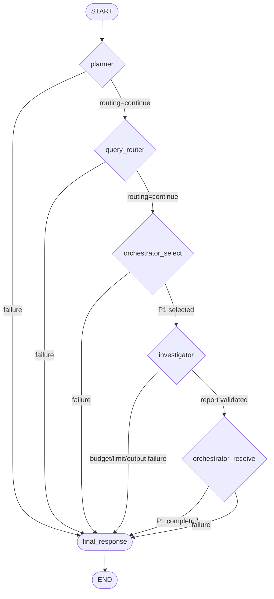

# LangGraph create_agent POC (middleware-protected)

**Status:** POC / extension — NOT on the production path.
**Package:** `src/repo_intelligence/langgraph_poc/`
**Optional extra:** `pip install -e .[poc]`
(langgraph 1.2.15, langchain 1.4.6, langchain-core 1.6.11,
langchain-openai 1.7.2 — the last only for the demo's `--live`
mode; the POC itself imports no provider SDK).
**Tests:** `tests/test_langgraph_poc.py` (27 behavioral tests; run with the `poc` extra installed).
**Demo:** `venv312/bin/python agentrun_langgraph_poc.py --verbose`
(offline default, exit 0).

## 1. Goal

Prove — with code and behavioral tests, not a design doc — that the
project's generic ReAct context-safety controls
(`repo_intelligence.react_safety`: request-budget enforcement,
observation bounding, execution limits) can be adapted as REAL
langchain `AgentMiddleware` around a REAL `create_agent` investigator
inside a LangGraph `StateGraph` workflow, while reusing the existing
typed contracts (planning, role assignment, task payload,
investigation report) without modification.

## 2. Graph topology (actual implementation)



State: `LangGraphPocState` (`TypedDict, total=False`) — the question,
scopes, validated `InvestigationPlan`, `RoleAssignment` list,
selected step/`TaskPayload`, validated `InvestigationReport`,
completed step ids, routing/failure bookkeeping, and the final
response dict. No repository contents, no unbounded tool output, no
conversation history in the graph state.

Nodes (all in `langgraph_poc/graph.py`):

| Node | What it does | Existing contract reused |
|---|---|---|
| `planner` | `build_planning_request` + injected `LLMClient.complete` + `plan_from_response` + `validate_plan`; then the POC's four-step shape check (ids P1-P4, non-empty goals — the model authors the goals, the application only validates) | `planning.planner`, `planning.validation` |
| `query_router` | `assign_roles(steps, role_overrides={P1-P3: INVESTIGATOR, P4: ANALYST})` + exact-coverage validation | `orchestration.roles` |
| `orchestrator_select` | selects the FIRST step (P1), requires INVESTIGATOR, builds `TaskPayload(question, repository_scope, commit_scope)` | `multiagent.contracts.TaskPayload` |
| `investigator` | `create_agent`-built agent on the selected task only; reads `structured_response` and type-checks | `InvestigationReport`, `react_safety` via middleware |
| `orchestrator_receive` | re-validates the report, records P1 completed (never on failure) | `InvestigationReport` |
| `final_response` | `{"status", "failure", "error", "report", "completed_step_ids"}` — FAILED flows carry an explicit reason, never a fabricated report | — |

The ANALYST assignment for P4 is metadata only: no Analyst agent is
invoked in this POC.

## 3. Middleware (the safety seam)

Built by `build_create_agent_investigator` in this exact order
(first = outermost — pinned by the budget-vs-limit order test):

1. **`RequestBudgetMiddleware`** (`wrap_model_call`, every call) —
   converts the outgoing `ModelRequest` to the project's
   `LLMRequest` (system + messages + tool definitions +
   structured-output schema) and delegates to
   `agent.request_budget.enforce_request_budget_or_raise`. Accepted:
   untouched. Reduced: bounded messages written back via
   `ModelRequest.override`. Rejected:
   `RequestBudgetExceededError` — provider never reached, request
   never retried unchanged.
2. **`ExecutionLimitMiddleware`** (`wrap_model_call` +
   `wrap_tool_call`) — adapts `react_safety.ReActLoopGuard`
   (config: `ReActSafetyConfig`), including iteration, model-call,
   tool-call, and configured cumulative-input ceilings. It uses the
   request-budget estimate when provider usage metadata is absent and
   preflights the projected cumulative total before the next provider
   call. On exhaustion raises typed
   `ReActExecutionLimitExceeded` with the guard's terminal status
   (`MODEL_CALL_LIMIT_REACHED` / `TOOL_CALL_LIMIT_REACHED` /
   `REQUEST_BUDGET_EXCEEDED` …). A budget rejection is noted via
   `note_budget_rejection` → guard terminal status, zero model
   calls counted.
3. **`ObservationBoundingMiddleware`** (`wrap_tool_call`) — bounds
   each tool observation with `react_safety.bound_observation`
   (default ceiling = the tool protocol's
   `MAX_TOOL_RESPONSE_CHARS`, 24,000 chars) BEFORE the ToolMessage
   joins history; the next model call sees the bounded excerpt +
   continuation hint.

No second safety implementation exists: the middleware module
imports and delegates (`test_middleware_reuse_no_duplicate_
safety_implementation` pins this by source scan).

## 4. Tool seam

`langgraph_poc/tools.py` adapts the project's already-bound tool
callables (`repository_query.live_bindings` output, or fixture
bindings) as `StructuredTool`s carrying the EXISTING
`AGENT_TOOL_DEFINITIONS` description + JSON schema. The tool
functions are never re-implemented; results come back as the
`ToolResult` JSON string — the same serialization the production
conversation seam embeds. A requested tool name without a binding is
skipped, never silently wrapped.

## 5. Two independent limits

* `GRAPH_RECURSION_LIMIT = 25` — outer graph steps
  (`config={"recursion_limit": ...}` at `graph.invoke`).
* `AGENT_RECURSION_LIMIT = 12` — the investigator agent's own
  langgraph step budget (each model/tool round inside
  `create_agent`).

The middleware's model/tool ceilings normally stop the loop first;
the recursion limits are last-resort bounds. Neither replaces the
other — a generous graph limit cannot bypass the agent's ceilings.

## 6. Failure taxonomy (explicit, never fabricated)

| Failure | Where raised | Final status |
|---|---|---|
| `PLANNER_FAILED` | planner node (schema/validation/POC-shape errors) | FAILED |
| `ROUTER_FAILED` | query_router (role/coverage errors) | FAILED |
| `SELECTION_FAILED` | orchestrator_select (not-INVESTIGATOR / empty scopes / unexpected id) | FAILED |
| `REQUEST_BUDGET_EXCEEDED` | budget middleware → investigator node | FAILED |
| `MODEL_CALL_LIMIT_REACHED` / `TOOL_CALL_LIMIT_REACHED` | execution middleware | FAILED |
| `MISSING_STRUCTURED_OUTPUT` | investigator node (no validated report) | FAILED |
| `RECEIVE_FAILED` | orchestrator_receive (re-validation) | FAILED |
| `INVESTIGATOR_FAILED` | any other investigator exception | FAILED |

Every failure flows to `final_response` with `report=None` and an
empty `completed_step_ids` — a safety failure can never flow onward
as a valid result.

## 7. How to run

```bash
# offline (scripted models, deterministic, no network)
venv312/bin/python agentrun_langgraph_poc.py --verbose   # exit 0

# live (needs OPENAI_API_KEY; planner via OpenAILLMClient,
# investigator via caller-supplied ChatOpenAI, real tool bindings)
venv312/bin/python agentrun_langgraph_poc.py --live \
    --repository /path/to/repo

# tests (importorskip: absent extra skips, never fails)
venv312/bin/python -m pytest tests/test_langgraph_poc.py -q
```

## 8. Provider neutrality

The POC imports NO provider SDK. The planner is the project's
provider-neutral `LLMClient` (injected); the investigator model is
any `BaseChatModel` supplied by the caller (the demo's `--live`
builds `ChatOpenAI` from the same `OPENAI_API_KEY`/`DEFAULT_MODEL`
configuration the `llm` package uses). Guard tests:
`test_langchain_framework_imports_confined_to_poc_package`,
`test_poc_package_never_imports_a_provider_sdk`.

## 9. Honest limitations

* Live model behavior is UNVERIFIED here (no `OPENAI_API_KEY`);
  everything above is proven offline with scripted models.
* Token figures are the project's ratio-based ESTIMATES (4 chars ≈
  1 token) unless the model reports usage metadata — never exact
  counts, never a monetary cap.
* The POC plan shape (exactly P1-P4) is a POC constraint, not the
  production planner's contract.
* No parallelism, no checkpointing, no replanning, no Analyst
  execution, no default flip of any production path.
* `langchain-openai` is pinned in `requirements.txt` because
  langchain-openai 1.7.2 requires openai >= 2.45 (venv now carries
  openai 3.35.1); the provider-neutral `llm` contract and its test
  suite pass on both 1.x and 3.x (verified: `tests/llm/` green).

## 10. Future work

* Wire the Investigator's real `live_bindings` evidence acceptance
  loop (read-before-cite) through the agent's tool set.
* The POC middleware enforces an explicitly configured cumulative
  input-token ceiling using provider-reported usage when available and
  otherwise the existing request-budget estimate. This is specific to
  the LangGraph POC; it does not change the legacy production Agent's
  cumulative-budget behavior.
* Parallel P2/P3 steps (langgraph fan-out) once the sequential POC
  graduates.
