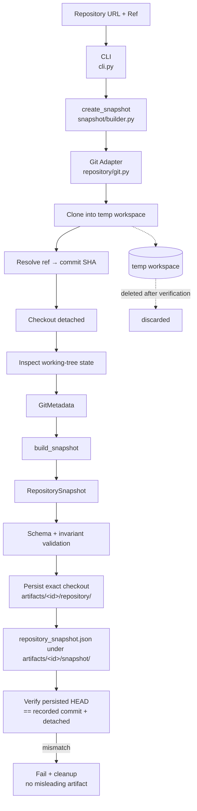

# M1 — Repository Snapshot

## What is M1?

M1 establishes **which repository state we are talking about** before any analysis happens.

If two people analyze "the project" but one looks at `main` five minutes later than the other, they are not looking at the same code. Architecture conclusions built on an ambiguous snapshot are not reproducible.

M1 takes a **repository URL** and a **Git ref** (tag, branch, or commit), resolves that ref to an exact commit SHA, and writes a small JSON artifact that identifies that state forever.

The full commit SHA is the **authoritative repository-state identifier**. Everything else in the snapshot is context around that identity.

M1 is intentionally deterministic: no LLMs, no agents, no network APIs beyond `git clone`.

## M1 Input

```text
repository_url   # e.g. https://github.com/aws-samples/sample-Agentic-Ai-Data-Operations.git
ref              # e.g. v1.0.0, main, or a full/short commit SHA
```

Example JSON-shaped input:

```json
{
  "repository_url": "https://github.com/aws-samples/sample-Agentic-Ai-Data-Operations.git",
  "ref": "v1.0.0"
}
```

CLI form:

```bash
python -m repo_intelligence snapshot \
  --repo https://github.com/aws-samples/sample-Agentic-Ai-Data-Operations.git \
  --ref v1.0.0
```

## M1 Output

A **`RepositorySnapshot`** serialized as JSON, validated against schema **`repository_snapshot.v1`** (`schemas/repository_snapshot.v1.json`).

```json
{
  "schema_version": "repository_snapshot.v1",
  "repository": {
    "name": "sample-Agentic-Ai-Data-Operations",
    "url": "https://github.com/aws-samples/sample-Agentic-Ai-Data-Operations.git"
  },
  "snapshot": {
    "ref": "v1.0.0",
    "commit_sha": "<full-40-character-sha>",
    "commit_short_sha": "<short-sha>",
    "captured_at": "<ISO-8601-timestamp>"
  },
  "workspace": {
    "working_tree_clean": true
  },
  "analyzer": {
    "name": "repository-intelligence",
    "version": "0.2.0"
  }
}
```

### Field meanings

| Field | Why it exists |
| --- | --- |
| `schema_version` | Pins the contract so later milestones can evolve the format safely. |
| `repository.name` | Human-readable name derived from the URL. |
| `repository.url` | Exact source URL — part of repository identity. |
| `snapshot.ref` | What the caller asked for; useful for provenance even though SHA is authoritative. |
| `snapshot.commit_sha` | **Authoritative state id** — full 40-char SHA of the checked-out commit. |
| `snapshot.commit_short_sha` | Convenience for humans and directory names. |
| `snapshot.captured_at` | When we captured this state (UTC, ISO-8601). Part of the *capture event*, not repository identity. |
| `workspace.working_tree_clean` | Explicit record of dirty/clean tree; never silently ignored. |
| `analyzer.name` / `analyzer.version` | Which tool version produced the artifact (reproducibility of the *producer*). |

### Snapshot identifier

Human-friendly folder name:

```text
<ref>_<YYYY-MM-DD>_<short-sha>
```

Examples:

```text
v1.0.0_2026-09-22_ef11dac
main_2026-09-22_a1b2c3d
```

For non-release refs such as `main`, the ref string is used as-is (sanitized for the filesystem) rather than pretending a release exists.

### Repository identity ≠ capture event

```text
Repository identity
    = repository.url + snapshot.commit_sha  (+ ref as provenance)
    → stable across repeated captures of the same commit

Capture event
    = captured_at (+ analyzer version)
    → may differ each run
```

Running M1 twice against the same immutable commit yields identical `commit_sha`, `repository.url`, and `ref`. Only `captured_at` may differ.

## How M1 Works

```text
Input (repository_url, ref)
 ↓
Clone repository into a temporary local Git workspace
 ↓
Resolve ref → exact commit SHA
 ↓
Checkout that commit (detached HEAD)
 ↓
Inspect working-tree state (git status --porcelain)
 ↓
Build RepositorySnapshot
 ↓
Validate against repository_snapshot.v1 schema + invariants
 ↓
Persist the exact checkout (copy incl. Git metadata) to
  artifacts/<ref>_<date>_<short-sha>/repository/
 ↓
Write artifacts/<ref>_<date>_<short-sha>/snapshot/repository_snapshot.json
  (and schema copies under artifacts/<id>/schemas/)
 ↓
Verify persisted git HEAD == recorded commit_sha and HEAD is detached
  (on failure: remove the persisted checkout + snapshot JSON and raise)
 ↓
Temporary workspace is deleted (the verified pinned copy remains)
```

Three layers stay distinct:

```text
source repository               (remote or local origin)
       ↓
temporary Git workspace         (deleted after persistence + verification)
       ↓
run directory artifacts/<id>/   (the only stored output)
    ├── repository/   pinned checkout, detached at the recorded commit
    └── snapshot/     repository_snapshot.json (+ schemas/)
```

**Core invariant:** the git HEAD of `artifacts/<id>/repository/` equals
the snapshot's recorded `commit_sha`. A generated run therefore always
contains the exact repository snapshot it was analyzed from — this is
what M2 reuses and what the evidence tools search/read against.

## Code Flow

```text
cli.py  (argparse: --repo, --ref, --output, --on-dirty)
   ↓
snapshot/builder.py::create_snapshot()
   ↓ clone + checkout
repository/git.py  (clone_repository, checkout_ref, inspect_workspace)
   ↓ GitMetadata(commit_sha, commit_short_sha, working_tree_clean)
snapshot/builder.py::build_snapshot()
   ↓ RepositorySnapshot
snapshot/builder.py::validate_snapshot_invariants()
snapshot/builder.py::validate_snapshot_document()  → schemas/repository_snapshot.v1.json
   ↓
snapshot/builder.py::_persist_pinned_repository()   (shutil copy, incl. .git)
   ↓
artifacts/<snapshot_id>/repository/
   ↓
snapshot/builder.py::write_snapshot_artifact()
   ↓
artifacts/<snapshot_id>/snapshot/repository_snapshot.json
   ↓
snapshot/builder.py::_verify_pinned_repository()
   (repository/git.py::get_head_sha + is_detached_head must match the record)
```

Git shell commands exist **only** in `repository/git.py`.

## Architecture Diagram



## Files Used

| Path | Purpose |
| --- | --- |
| `src/repo_intelligence/__init__.py` | Package version (`0.2.0`) used as `analyzer.version`. |
| `src/repo_intelligence/__main__.py` | Enables `python -m repo_intelligence`. |
| `src/repo_intelligence/cli.py` | CLI entry: parses args, calls `create_snapshot`, prints report, maps errors to exit codes. |
| `src/repo_intelligence/repository/git.py` | All Git CLI operations: clone, resolve ref, checkout, SHA, detached-HEAD check, cleanliness. Defines `GitMetadata` and Git errors. |
| `src/repo_intelligence/repository/__init__.py` | Re-exports the Git adapter surface. |
| `src/repo_intelligence/snapshot/models.py` | `RepositorySnapshot` domain model, `snapshot_id` generation, ref sanitization. |
| `src/repo_intelligence/snapshot/builder.py` | Pipeline: clone → inspect → build → validate → persist exact checkout → verify HEAD → write artifact. Schema loading/validation. |
| `src/repo_intelligence/snapshot/__init__.py` | Public snapshot API exports. |
| `src/repo_intelligence/artifacts.py` | Shared `artifacts/<id>/` layout helpers (`repository/`, `snapshot/`, schema copies). |
| `schemas/repository_snapshot.v1.json` | JSON Schema for `repository_snapshot.v1`. |
| `tests/test_snapshot.py` | Contract tests against local temp Git repos (no GitHub dependency), including persistence + HEAD-equality + mismatch-detection tests. |
| `artifacts/` | Single generated-output root (`<id>/repository/` pinned checkout, `<id>/snapshot/repository_snapshot.json`, `<id>/schemas/`). |
| `docs/m1-repository-snapshot.md` | This document. |
| `README.md` | Project overview + M1 quick start. |
| `pyproject.toml` | Packaging, `jsonschema` dependency, console script. |

## Testing

### Unit tests (`tests/test_snapshot.py`)

All primary tests use a **local temporary Git repository** (init, commit, tag `v1.0.0`) so they run offline:

1. Valid repository + valid ref  
2. Invalid ref → `RefResolutionError`, no artifact written  
3. Invalid repository → `CloneError`  
4. Commit SHA resolution (full + short, matches `git rev-parse HEAD`)  
5. Working-tree state (clean after clone; dirty detected; `on_dirty='fail'`)  
6. Snapshot identifier generation (tag form + branch form + slash sanitization)  
7. JSON Schema validation (accept good docs; reject bad SHA / wrong version)  
8. Artifact location/content under `artifacts/<id>/snapshot/repository_snapshot.json`  
9. Pinned checkout persisted at `<id>/repository/` — HEAD equals the recorded commit, HEAD is detached, no clone inside `snapshot/`  
10. Persisted-HEAD mismatch detection (fails, and no snapshot JSON / repository dir is left behind)  
11. Reproducibility of identity fields  
12. Round-trip `to_dict` / `from_dict`

### Integration-style test

`test_integration_full_workflow` runs the real Git workflow end-to-end through `create_snapshot` against a local remote: clone → resolve tag → snapshot → schema-validate → persist + verify pinned checkout → artifact on disk.

### Manual / independent verification

Against the ADOP sample repository (performed 2026-09-22):

```bash
git clone https://github.com/aws-samples/sample-Agentic-Ai-Data-Operations.git /tmp/adop-verify
cd /tmp/adop-verify
git checkout main    # or any available tag, e.g. demo/before-onboarding
git rev-parse HEAD
git status --porcelain
```

Note: the ADOP repository has no `v1.0.0` tag. Available tags include
`demo/*` and `semantic-layer/*`. Manual verification used `main` and
`demo/before-onboarding`.

Then from this project:

```bash
python -m repo_intelligence snapshot \
  --repo https://github.com/aws-samples/sample-Agentic-Ai-Data-Operations.git \
  --ref main
```

Observed agreement:

```text
snapshot.commit_sha  ==  git rev-parse HEAD
                     ==  ef11dac8618b6344d6a5e4add6ef51cd2811d7e0
snapshot.commit_short_sha == git rev-parse --short HEAD == ef11dac
working_tree_clean   ==  true   (git status --porcelain empty)
```

Also verified: invalid ref → exit 5 with a clear message; nonexistent
repository → exit 4 with a clear message; generated JSON validates against
`schemas/repository_snapshot.v1.json`.

### Reproducibility verification

Run the CLI twice against the same immutable commit and confirm:

```text
commit_sha       → identical
repository URL   → identical
ref              → identical
captured_at      → may differ
```

Observed (2026-09-22), two runs against commit
`ef11dac8618b6344d6a5e4add6ef51cd2811d7e0`:

```text
repository.url / commit_sha / commit_short_sha / ref → identical
captured_at run1 = 2026-09-22T11:46:13.834445+00:00
captured_at run2 = 2026-09-22T11:46:17.492441+00:00
```

## What M1 Does NOT Do

M1 does **not**:

- understand architecture
- inspect application behavior
- build an architecture graph
- use an LLM
- use agents or agent frameworks (LangChain, LangGraph, CrewAI, …)
- use MCP
- perform semantic analysis
- call the GitHub API (local Git only)
- analyze dependencies
- store embeddings or use vector/graph databases

## Why M1 Exists

M2 and later milestones will analyze architecture, dependencies, and agent-related structures. Those analyses need a **stable, reproducible input boundary**.

M1 guarantees: *this exact commit, from this exact URL, captured with this tool version.* Without that boundary, later results cannot be compared, repeated, or trusted.

M1 also guarantees the run **contains** that exact state: `artifacts/<id>/repository/` is the verified checkout of the recorded commit, so every later step (M2 analysis, the evidence tools) operates on the same frozen snapshot rather than on "whatever the branch points at now".

## Error Handling

| Case | Behavior | Exit code |
| --- | --- | --- |
| Git not installed | Clear message that Git is required | 3 |
| Invalid / unreachable repository | `CloneError` with URL + git stderr | 4 |
| Invalid ref | `RefResolutionError` naming the ref | 5 |
| Schema/invariant failure or dirty-tree refusal | `SnapshotError` / `SchemaValidationError` | 6 |
| Persisted checkout fails HEAD/detached verification | `SnapshotError`; persisted checkout + snapshot JSON removed | 6 |
| Other Git failure | Git error detail (no raw traceback for expected cases) | 7 |

### Dirty working tree policy (explicit)

Default: **`--on-dirty warn`** — record `"working_tree_clean": false`, print a warning to stderr, still create the snapshot.

Alternative: **`--on-dirty fail`** — refuse to create a snapshot.

There is no silent ignore of dirtiness: the field is always present in the artifact.

Note: a fresh `git clone` + detached checkout of a committed ref is almost always clean; dirty state matters more when reusing a local workspace path in future milestones.

## Running tests

```bash
pip install -e .
pip install pytest jsonschema
pytest tests/ -v
```
