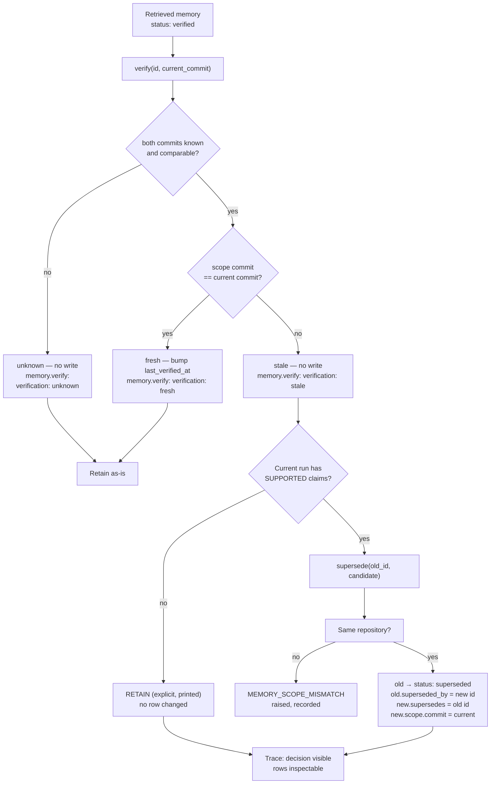

# M14 — Persistent Agent Memory

> **Status:** implemented, validated, frozen. The smallest change that
> lets one execution's validated conclusions survive into the next —
> a repository-agnostic SQLite memory layer behind an injected
> `MemoryManager`, deterministic retrieval at the execution boundary,
> explicit lifecycle (verify → retain / supersede / invalidate), two
> real OS processes sharing one database — with every M1–M13 test
> still green.

## 1. Why M14 exists

M13 made one run's conclusions traceable: claims grounded in inspected
files, validated deterministically, measured by the evaluator. Then
the run ended. The trace is written to `runtime/agent_runs/…` and the
conversation — plan, tool results, validated claims — evaporates. The
next execution starts with an empty context and re-investigates from
zero.

Inside a single execution, "memory" already exists and works: the
message list accumulates every observation, the planner sees the
architecture context, the loop carries `PlanStep` state. That working
memory is exactly what makes multi-step investigation possible — and
it dies with the process. Nothing about the *conclusions* survives:
not the statements, not the evidence they were grounded on, not the
commit they were true at.

M14 closes exactly that gap, one persistence capability:

> **Execution 1 investigates → the application selects validated
> conclusions → they are stored with scope, owner, and evidence →
> execution 2 (a genuinely new OS process) retrieves them at its
> execution boundary, uses them as a starting point, and checks them
> against current evidence — retaining, superseding, or invalidating
> explicitly.**

It is a persistence milestone, not a new reasoning milestone: no
embeddings, no vector search, no consolidation, no auto-extraction,
no second agent (§11 non-goals).

## 2. What M14 does / does not do

### Does

- Adds `src/repo_intelligence/memory/` — a provider-neutral SQLite
  layer: contract validation, `mem_<uuid>` id generation,
  persistence, deterministic retrieval, lifecycle, provenance, and
  structured errors. **The package never imports an LLM client, a
  planner, or a tool.**
- Stores one **memory contract** per record: who (`owner`), what
  (`content.statement`), where/when (`scope` = repository + commit),
  why-trusted (`evidence[]`), and lifecycle `status`
  (`verified` / `superseded` / `invalid`).
- Retrieves through **exact/controlled matching only**:
  `search(repository, owner, subject, memory_type, status, limit)`
  is the primary mechanism (discovery); `get(memory_id)` is the
  secondary one (known-id lookup — never how discovery happens).
- Gives the `Agent` an **injected** `MemoryManager` +
  `MemoryContext` (`memory_manager=` / `memory_context=` ctor
  params). The Agent code contains **no `sqlite3` import** — memory
  operations are calls on the injected object, and every operation
  lands on the trace (`memory.retrieve` / `memory.verify` /
  `memory.store` / `memory.supersede` events).
- Retrieves at the **execution boundary** — before the planner runs,
  after the run loads its context — so memory shapes both the
  planning request and the conversation, while the M10 invariant is
  untouched: the plan is still produced before any *repository* tool
  executes (memory retrieval is not repository tool execution).
- Implements the **explicit lifecycle** with a **tri-state**
  freshness check: `verify(memory_id, current_commit)` reports
  `fresh` (both commits known and equal), `stale` (both known and
  different), or `unknown` (a commit is missing — never written up
  as fresh); the caller then *decides* — retain (no write),
  `supersede(old_id, candidate)` (old → `superseded` +
  `superseded_by`, new carries `supersedes`), or `invalidate(id)`
  (→ `invalid`, idempotent, never deletes rows).
- Forms new memory only from **this run's validated, supported
  claims** — the **deterministic memory formation policy**: a bounded
  selection step (`select_memory_candidates`, order-preserving,
  `MAX_MEMORY_CANDIDATES = 5`), same validation → same candidates,
  never model self-reporting.
- Surfaces structured errors (`MEMORY_NOT_FOUND`,
  `MEMORY_CONTRACT_VIOLATION`, `MEMORY_SCOPE_MISMATCH`,
  `MEMORY_INVALID`, `MEMORY_STORE_UNAVAILABLE`,
  `MEMORY_STORE_NOT_INITIALIZED`) — never silent fallbacks.
  Operation failures during a run are *recorded* as trace events
  (`error{code, message}` + `last_memory_error`) and never abort an
  investigation (same policy as sink errors).

### Does not

- No embeddings, vector stores, similarity search, ranking, or RAG.
  Retrieval is deterministic filtering; "relevance" is a future
  concern.
- No consolidation, summarization, or auto-extraction of memories
  from conversations. A memory is stored only through the explicit
  `MemoryManager.store(...)` call, reached via the deterministic
  memory formation policy over this run's validation.
- No second tracer, no second agent, no memory-specific CLI, no
  multi-agent memory protocol, no knowledge graph of memories.
- No change to the frozen M8–M13 stack: same planner, same ReAct
  loop, same four tools, same claim validation, same evaluator. A
  run without a memory manager behaves byte-for-byte as before
  (asserted by tests).

## 3. The memory contract

Every stored record (validated by `validate_candidate` before
persisting; the stored `Memory` adds server-managed fields):

| Field | Meaning |
| --- | --- |
| `memory_id` | `mem_<opaque-uuid4>` — **generated by the manager**, never by the model or the caller. The creation site receives it back from `store()`. |
| `owner{type,id}` | Whose memory this is (`agent` / `repo_intelligence.agent` in the demonstration; the package hard-codes nothing — owner identity is data). |
| `memory_type` | `semantic` or `episodic` (formation assigns; retrieval searches every type). |
| `content.statement` | The conclusion itself — one self-contained sentence. |
| `scope{repository,commit}` | Where/when it was true. Repository names are **data** (`"ADOP"` is a label, not a code path). |
| `evidence[]` | `EvidenceRef{path,line_start,line_end}` — the same reference type M13 claims use (memory reuses the frozen evidence vocabulary). |
| `status` | `verified` (stored by the deterministic memory formation policy), `superseded` (replaced by a newer record), `invalid` (explicitly retired). |
| `subject` | Optional grouping key for retrieval (the demonstration uses `"agents-tools-mcp"`). |
| `created_at` / `last_verified_at` | ISO-8601 UTC timestamps; `verify` bumps `last_verified_at` only when the scope still matches. |
| `source_run_id` | Provenance: which execution formed it. |
| `supersedes` / `superseded_by` | The inspectable supersede relationship (two nullable columns). |

Refinements over the minimal sketch — `subject`, `source_run_id`,
and the supersede pair exist because §24 (filtering), §34
(provenance), and §28 (relationship) require them; everything else is
exactly the §18 contract.

## 4. Storage — the actual SQLite schema

Database: `db_store/memory/agent_memory.db` (default path from
`default_memory_db_path()` — absolute, CWD-independent, gitignored;
relocatable through `REPO_INTELLIGENCE_DB_STORE`; pre-M18 installs at
`runtime/agent_memory/` migrate with
`python -m repo_intelligence.storage` — see `docs/storage-layout.md`.
Tests use temporary databases). Schema creation is deterministic and
idempotent (`initialize()`); the **initialized state is schema
presence** in `sqlite_master`, so a second OS process can operate on
a database this one created without calling `initialize()` again.

```sql
CREATE TABLE IF NOT EXISTS memories (
    memory_id      TEXT PRIMARY KEY,
    owner_type     TEXT NOT NULL,
    owner_id       TEXT NOT NULL,
    memory_type    TEXT NOT NULL,
    statement      TEXT NOT NULL,
    subject        TEXT,
    repository     TEXT,
    "commit"       TEXT,          -- quoted: SQLite keyword
    status         TEXT NOT NULL,
    created_at     TEXT NOT NULL,
    last_verified_at TEXT NOT NULL,
    source_run_id  TEXT,
    supersedes     TEXT,
    superseded_by  TEXT
);

CREATE TABLE IF NOT EXISTS memory_evidence (
    memory_id  TEXT NOT NULL,
    position   INTEGER NOT NULL,
    path       TEXT NOT NULL,
    line_start INTEGER,
    line_end   INTEGER,
    PRIMARY KEY (memory_id, position),
    FOREIGN KEY (memory_id) REFERENCES memories (memory_id)
);

-- indices: repository, (owner_type, owner_id), status, subject, memory_type
```

One connection per operation; every failure path is wrapped into
`MEMORY_STORE_UNAVAILABLE` (or `MEMORY_STORE_NOT_INITIALIZED` when
the file exists without schema). There is no fallback location — an
unwritable path is an error, not a different database.

## 5. Retrieval — deterministic, bounded, explicit

```python
manager = MemoryManager()                # default runtime path
memories = manager.search(               # primary: discovery
    repository="ADOP",
    owner=MemoryOwner("agent", "repo_intelligence.agent"),
    subject="agents-tools-mcp",
    status="verified",                   # optional lifecycle filter
    limit=10,                            # bounded, never "all"
)
one = manager.get(memory_id)             # secondary: known-id only
```

- Every filter is exact/controlled; ordering is deterministic
  (`created_at, memory_id`); `limit` defaults to 50 for direct
  calls and the Agent caps its own retrieval at `search_limit = 10`
  (the context field).
- Bad filter arguments (wrong type, negative limit) → `ValueError`
  at the call site — a programming mistake, not a memory error.
- Unknown id → `MEMORY_NOT_FOUND` (never a default record, never
  `None` masquerading as data).
- **Isolation invariant (repository scope is the anchor):**
  repository-derived execution retrieves **only its own
  repository's** memory — even when owner and subject match exactly,
  a different repository's memory never enters the execution. An
  execution whose scope carries **no repository** performs **no
  search at all**: it records a structured `MEMORY_SCOPE_MISMATCH`
  failure event and returns nothing — an unrestricted
  cross-repository search is never a silent fallback.
- The memory package is provider-neutral: no LLM imports anywhere
  in `src/repo_intelligence/memory/` (asserted by a source scan).

## 6. Integration boundary — the Agent never touches SQLite

```text
Agent.__init__(memory_manager: Optional[MemoryManager],
               memory_context: Optional[MemoryContext])
```

- No manager → every memory operation is a no-op (trace stays free
  of memory events; pre-M14 behavior byte-identical).
- Manager without context → default context with the Agent's own
  owner filled in (`agent` / `repo_intelligence.agent`).
- Context without manager → `ValueError` at construction (a
  configuration mistake, surfaced immediately).

Flow inside `run_planned` (the §19 real code path):

```text
question + architecture context + memory_context
   │  _retrieve_memories(trace)      ← repository scope required
   │                                    (no repository → recorded
   │                                    MEMORY_SCOPE_MISMATCH, NO
   │                                    search); then search():
   │                                    repository, owner, subject,
   │                                    status=verified, search_limit
   │                                    — BEFORE the plan
   ▼
render_memory_context(memories, current_commit)
   │  extra user message in the conversation (only when ≥1 memory)
   │  + appended to the planner request (build_planning_request)
   ▼
plan created + validated (M10 — unchanged invariant)
   │  ReAct loop executes steps (M8/M10 — unchanged)
   ▼
validate_claims(...) (M13 — unchanged)
   │
   ├─ _verify_memories(trace, memories, scope)   ← per retrieved memory:
   │      verify(id, current_commit) → memory.verify event,
   │      verification: fresh|stale|unknown
   │      (no write unless fresh — the CALLER decides)
   │
   └─ _form_memories(trace, validation, scope)   ← SUPPORTED claims only:
          select_memory_candidates(...) → store() → memory.store events
```

Memory errors during retrieve/verify/store are recorded as
`memory.{op}` events with `error{code, message}` and mirrored on
`agent.last_memory_error` — never fatal, never silent (the same
policy the Agent applies to trace-sink errors).

## 7. Lifecycle — staleness and the explicit decision

Verification is **tri-state** (never a boolean). The pure
`verification_status(memory, current_commit)` classifies:

- **fresh** — both commits known and equal;
- **stale** — both commits known and differ
  (`is_stale(...)` is exactly this case);
- **unknown** — a commit is missing on either side: the scopes
  cannot be compared. Unknown is **never** reported fresh (absence
  of a comparison is not a freshness claim) and never recorded as a
  completed check.

`verify()` bumps `last_verified_at` **only on fresh** (a scope
confirmation, not a re-approval of the statement) and performs **no
write** for stale or unknown — the decision to retain, supersede, or
invalidate is the caller's, always visible on the trace.



`invalidate(id)` is the third decision: → `status: invalid`,
idempotent, and it **never deletes** — a superseded or invalidated
row remains exactly as recorded (history is data).

## 8. Trace integration — one trace, memory as events

`AgentTrace` gains exactly one additive field
(`memory_events: List[Dict]`, omitted from `to_dict()` when empty so
legacy trace shapes stay intact) plus `record_memory_event()`
(deep-clipped like every other trace payload). Each event carries
`operation`, `memory_id`, `agent_id`, `run_id`, `repository`,
`commit`, `status` — and `error{code,message}` on failure.

The markdown trace renders a `## Memory` section (after Plan, before
iterations) with deterministic one-liners:

```text
## Memory
* memory.retrieve — 5 retrieved
* memory.verify — mem_3ae9a09e… — verification: fresh — status verified
* memory.verify — mem_85c52eb0… — verification: stale — status verified
* memory.store — mem_9de13be1… — status verified
```

No second trace, no hidden reasoning field, no memory-specific
markdown file — memory is events on the same `AgentTrace` the M8.8
rendering already consumes.

## 9. Demonstration — two tasks, two OS processes

`python agentrun_m14_memory_demo.py` (exit 0 = both phases green;
1 = nothing retrievable / memory error recorded; 6 = execution
failure):

- **Execution 1 (this process)** — Task 1 (the M13 controlled
  objective) runs plan-first through the existing planner and loop;
  supported claims are formed into memories; one clearly-labelled
  *legacy* memory is stored at an older commit
  (`…ef11dac…cd00000000`, "simulated repository history").
- **Execution 2 (a new OS process, `--phase retrieve`)** — the
  child opens the same SQLite file, prints `OS pid …: Task 1's
  messages, plan, and tool results never existed in this process —
  only the SQLite file was shared`, retrieves through `search()`,
  runs Task 2 (memory is *a starting point, never a substitute*),
  verifies each retrieved memory against the current commit, and
  prints the stale decision.

Live run (pinned snapshot `main_2026-09-22_ef11dac`, `gpt-4o-mini`,
budget 60):

| | Execution 1 (store) | Execution 2 (retrieve, **pid 1326958**) |
| --- | --- | --- |
| plan | 5/5 `completed` | 5/5 `completed` (P3: "Cross-verify … with the claims recorded in **persistent memory**") |
| iterations / tool calls | 14 / 30 (4 search, 25 read, 1 context) | 8 / 3 (2 search, 1 context) |
| claims | **4 → 4/4 SUPPORTED** | 5 → 0 supported (no `read_file` → nothing inspected) |
| memory ops | `retrieve 0` → `store ×4` (+ legacy) | `retrieve 5` → `verify ×5` (4 fresh, **1 stale**) |
| decision | — | **RETAINED** (no validated replacement) |

Second retrieve pass (fresh process **pid 1327446**): 16 iterations
(some failed tool calls recovered within budget), **4/4 claims
SUPPORTED**, `store ×4`, stale legacy → **SUPERSEDED** with
replacement `mem_fb03201f…` re-established at the current commit:

```text
* SUPERSEDED: mem_85c52eb003f7454ea786e46d0675ca11
    old (superseded): Earlier investigation: … agent definitions and MCP tool declarations.
    new: mem_fb03201f20414721a3f7e93ac79b1a79 @ ef11dac8618b
    reason: current evidence supports the finding (…, SUPPORTED)
```

Both stale paths — retain and supersede — were produced by the real
model; the retained/verified rows and the `superseded` row are all
inspectable in `db_store/memory/agent_memory.db` afterwards.

## 10. Testing

```bash
PYTEST_DISABLE_PLUGIN_AUTOLOAD=1 python -m pytest tests/memory/ -q
# → 133 passed
# full suite: 1237 passed, 1 skipped
# (M13 frozen baseline 1103 untouched + 133 M14 tests; the M14
#  correction pass added 9 tests and intentionally updated 4
#  expectations — no non-M14 test was modified)
```

| File | Tests | Covers |
| --- | --- | --- |
| `tests/memory/test_memory_contract.py` | 36 | field-by-field validation, id shape/unicity, vocabulary, serialization round-trips, provider-neutrality source scan |
| `tests/memory/test_memory_store.py` | 9 | persistence, schema/index presence, **cross-process subprocess proof**, `MEMORY_STORE_NOT_INITIALIZED` / `MEMORY_STORE_UNAVAILABLE`, default path under `db_store/` (env-relocatable) |
| `tests/memory/test_memory_retrieval.py` | 16 | every filter dimension, exact matching, deterministic ordering, bounded limits, `ValueError` argument errors |
| `tests/memory/test_memory_lifecycle.py` | 19 | tri-state verify — fresh (bump)/stale (no write)/unknown (no write, never fresh), wrong-typed commit `ValueError` (monkeypatched clock), supersede relationship + `MEMORY_SCOPE_MISMATCH` + `MEMORY_INVALID` transitions, invalidate idempotence, full lifecycle walk |
| `tests/memory/test_memory_formation.py` | 11 | SUPPORTED-only selection, order preservation, `MAX_MEMORY_CANDIDATES` bound, deterministic same-input-same-candidates policy |
| `tests/memory/test_memory_agent_integration.py` | 14 | no-manager byte-identical behavior, store-from-supported-claim, unsupported never persists, second-task retrieval into messages/planner, verify events (+ `verification_status` field), missing-repository-scope refusal, uninitialized-store error events, no hidden reasoning |
| `tests/memory/test_memory_isolation.py` | 4 | **repository isolation invariant**: same repository retrieved, other repository excluded, same owner+subject still never crosses repositories, missing scope → no search + structured `MEMORY_SCOPE_MISMATCH` |
| `tests/memory/test_memory_trace.py` | 7 | `memory_events` field shape, clipping, `to_dict` omission when empty, markdown `## Memory` render, tri-state `verification: fresh/stale/unknown` (never flattened to `stale: no`) |
| `tests/memory/test_m14_memory_demo.py` | 17 | offline store/retrieve phases (scripted LLM), stale retain + supersede outputs, real `subprocess.run` argv, `main` paths (default both-mode = store then spawn, `--phase store/retrieve`, no-key → 6, empty store → 1), composition-root source scan |

LLM-free throughout (fake clients/scripts); the only process
boundary exercised for real is the `subprocess.run` spawn (argv) and
the cross-process SQLite proof (child interpreter). Full regression:
`pytest tests/`, `compileall`, `pyflakes` on touched files, harnesses
6/6, 8/8, 10/10, 13/13.

## 11. Non-goals (§56 — explicitly deferred)

- **Embeddings / vector search / RAG** — retrieval is filtering;
  semantic similarity is a different mechanism with different
  failure modes.
- **Ranking & consolidation** — no merging of similar memories,
  no decay, no summarization across runs.
- **Automatic extraction** — memories never appear because a model
  *mentioned* something; formation is the explicit bounded selection
  from validated claims.
- **Multi-agent memory sharing / protocols** — one owner identity
  per execution in the demonstration; cross-agent memory is a design
  conversation, not a column.
- **Scale infrastructure** — no migrations, no sharding, no cache
  layer. SQLite under `db_store/memory/` is the whole storage story.
- **CLI additions** — the demonstration script is the interface;
  nothing new to learn for operators.

## 12. Boundary and philosophy

- **Memory ≠ evidence.** Evidence is what *this* run inspected
  (M13); memory is what a *previous* run concluded. Memory is
  rendered as a starting point and must be re-confirmed — current
  evidence wins on any conflict, always.
- **Current evidence beats old memory.** Staleness is scope-based
  and objective; the decision after staleness is explicit and
  recorded — never a silent rewrite, never a deletion.
- **The application owns memory; the model only benefits from it.**
  The Agent never invents ids, never writes rows directly, never
  sees SQL — it calls the injected manager, and every call lands on
  the trace. Validation, selection, and lifecycle transitions are
  deterministic code.
- **Memory never replaces investigation.** Retrieval happens at the
  execution boundary; the investigation still runs its plan, its
  tools, and its claim validation exactly as before. A run whose
  memory layer fails still executes (error recorded, run proceeds).
- **One trace, one contract, one loop** — M8.8/M8.9 exclusivity, the
  M10 plan-first invariant, and the M13 validator are untouched;
  memory adds events, not architectures.

## 13. Definition of done

- [x] `src/repo_intelligence/memory/` — contract, ids, SQLite store,
      deterministic `search`/`get`, lifecycle
      (`verify`/`supersede`/`invalidate`), structured errors; no LLM
      imports.
- [x] Agent integration via injected `memory_manager` /
      `memory_context` only — no `sqlite3` in `agent.py`;
      byte-identical behavior with no manager.
- [x] Retrieval at the execution boundary; plan-first invariant and
      claim validation unchanged.
- [x] **Repository isolation invariant**: scopeless execution never
      searches (structured `MEMORY_SCOPE_MISMATCH`); cross-repository
      retrieval impossible — proven by 4 isolation tests.
- [x] **Deterministic memory formation policy** — same validation →
      same candidates; wording corrected everywhere (no
      "intelligent/LLM selection" semantics anywhere in M14).
- [x] **Tri-state verification** — `fresh`/`stale`/`unknown`; only
      fresh bumps `last_verified_at`; unknown never rendered or
      recorded as fresh.
- [x] Trace: `memory_events` + `## Memory` section; error events
      recorded, never fatal, never silent.
- [x] `agentrun_m14_memory_demo.py` — two tasks, **two real OS
      processes**, shared SQLite; live exit 0 with RETAIN and
      SUPERSEDE both observed.
- [x] `tests/memory/` — 133 tests, LLM-free, cross-process proof
      (incl. 4 repository-isolation tests);
      full suite 1237 passed / 1 skipped; harnesses 6/6, 8/8, 10/10,
      13/13.
- [x] **Runtime hygiene** — generated
      `runtime/agent_memory/agent_memory.db` removed from the source
      snapshot (`runtime/` gitignored; tests use temporary databases).
- [x] Docs: this file, README narrative + milestones row, plan doc
      §39 — all counts verified against the actual suite run.

## 14. Learning progression

```text
M13  claims → evidence → deterministic validation        (within one run)
M14  validated conclusions → SQLite → next run retrieves
      → staleness → explicit retain/supersede/invalidate (across runs)
M15+ consolidation / similarity / multi-agent (deferred, §11)
```

The stack stays honest at every step: M13 proved a conclusion is
checkable; M14 proves a checkable conclusion *survives* — with its
scope, its owner, and its evidence attached — and that the run which
inherits it must still do its own investigating.
