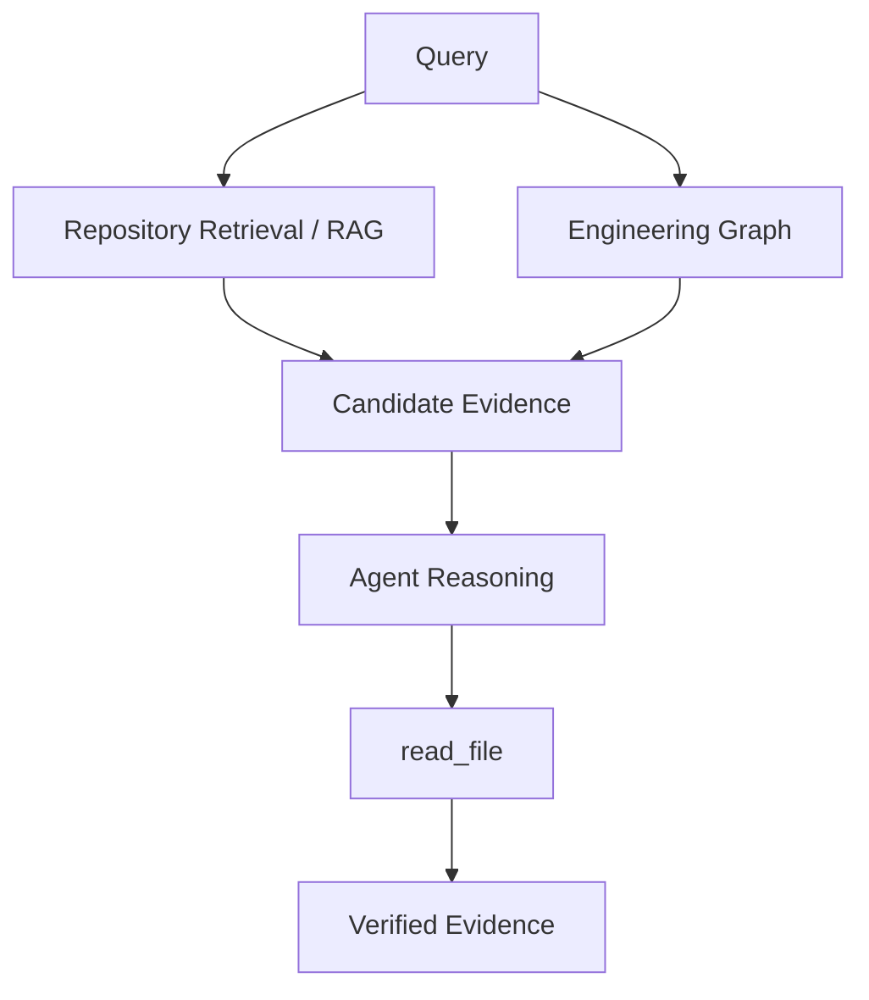

# M18 — Repository Retrieval Intelligence

RAG-based semantic repository search (`search_repository()`), the
Engineering Graph as the deterministic relationship source, and
`read_file()` as the evidence verifier — one diagnostic flow that
proves the whole path offline.

## Motivation

Deterministic file walks and keyword matching return too much
irrelevant context. Repository semantic retrieval reduces irrelevant
search results and provides compact, provenance-aware evidence
candidates. Existing execution safeguards remain necessary.

## Architecture



Components:

| Layer | Module | Role |
| --- | --- | --- |
| Chunking | `retrieval/chunking.py` | deterministic spans per file |
| Embeddings | `retrieval/embeddings.py` | ST model or offline hashing |
| Index | `retrieval/index.py` | FAISS vectors + manifest |
| Metadata | `retrieval/metadata.py` | SQLite provenance rows |
| Identity | `retrieval/identity.py` | repository + commit + model |
| Service | `retrieval/service.py` | bounded, read-only search |
| Tool | `tools/search_repository.py` | `ToolResult` contract |
| Graph | `tools/query_engineering_graph.py` | deterministic relationships |
| Verifier | `tools/read_file.py` | exact source ranges |

## Ingestion

`iter_indexable_files()` walks the pinned checkout only:

* searchable extensions (text/code, per the shared file policy in
  `facts/filesystem.py`);
* skips `node_modules/`, `.venv/`, `.git/`, build/cache directories;
* skips binary content, files over `MAX_FILE_BYTES` (1 MB), and
  symlinks that resolve outside the checkout;
* never reads outside the pinned repository.

## Chunking

* deterministic line ranges — same input, same chunks, same
  `chunk_id` (SHA-1 of path + range + content hash);
* Python files are segmented at AST boundaries (imports, module
  prelude, classes, functions, methods) and only then windowed;
* every other supported language uses line windows
  (`chunk_lines=40`, `chunk_overlap=8`);
* blank-only files contribute nothing.

## Embeddings

* production: `sentence-transformers://BAAI/bge-small-en-v1.5`
  (lazy load, recorded in the index manifest);
* offline/deterministic: `hashing://v1/<dimension>` — SHA-1 feature
  bucketing, signed accumulation, L2-normalized vectors; used by
  every test and by the deterministic demo path;
* no implicit fallback: an index is built with the model it will be
  queried with (`embedder_for()` rejects unknown schemes).

## Indexing

Layout (under the rag store, default `<db_store>/rag/`):

```text
<db_store>/rag/
└── <repository_key>/
    └── <commit_sha>/
        └── <embedding_model>/     # manifest.json + index.faiss
```

* metadata rows (path, lines, chunk id, language, content hash,
  excerpt, provenance) live in `<db_store>/rag/metadata.db`;
* `build_index()` is idempotent — an existing complete index reports
  `reused: true` unless `--force` is passed;
* build entry points:
  `python -m repo_intelligence.retrieval.index --repository-root <checkout>`,
  `repo-intelligence retrieval-index ...`, or the flow script's
  explicit build step (queries never build implicitly);
* `delete_index()` removes vectors and metadata rows together.

## Retrieval

`search_repository({"query", "path"?, "max_results"?})`:

* embeds the query with the index's own model, searches FAISS,
  ranks by cosine similarity with a stable tie-break
  `(-score, file_path, line_start, chunk_id)`;
* `top_k` default 5, maximum 50;
* `path` restricts results to a repository-relative file or
  directory (traversal and symlink escapes are rejected with the
  established `PATH_*` errors);
* no zero-score filtering — a query with no overlap still returns
  bounded candidates (`similarity_score == 0.0`), never a dump;
* `total_matches` is the honest scanned/matched count;
* every result carries §26 provenance: `similarity_score`,
  `repository_name`, `commit_sha`, `snapshot_id`, `chunk_id`,
  `file_path`/`path`, `line_start`, `line_end`, `language`,
  `excerpt`.

## Graph integration

The Engineering Graph stays the source of truth for relationships
(§47). RAG is a retrieval projection and is regenerable: building or
querying the index never writes an edge, and the persisted
`engineering_graph.json` stays byte-identical across retrieval
activity. If RAG evidence and deterministic graph information
disagree, do not silently reconcile — expose the discrepancy.

## Read-file verification

For every selected candidate the flow calls the existing
`read_file()` with the exact `path` + `line_start`/`line_end` and
prints the numbered source (`42 | ...`) it actually read. Verified
evidence is typed `CODE` or `GRAPH_RELATIONSHIP`.

## Evidence provenance

Every retrieval result, flow candidate, and verified block carries
`repository_name + commit_sha + snapshot_id` (or the run's identity)
so downstream evidence can be traced to the pinned snapshot it came
from.

## Commit isolation

Index identity = `(repository_name, commit_sha, embedding_model)`.
Two commits of the same repository and two different repositories
get structurally separate index directories and separately scoped
SQLite rows — queries can never cross them (§33 commit/repository
isolation tests, §44 dual fixtures).

## Storage

```text
artifacts/           # pinned snapshots, facts, architecture, graph
db_store/
└── memory/          # agent_memory.db (M14) + repository_query.db (M9+)
└── rag/             # FAISS index + manifest + metadata.db (M18)
runtime/             # ephemeral trace/log output ONLY — never DBs,
                     # never vector indexes
```

`REPO_INTELLIGENCE_DB_STORE` relocates the whole `db_store` tree
(test isolation uses it). See `docs/storage-layout.md` for
ownership.

## Re-indexing

* same content, same model → `reused: true` (cheap to ask twice);
* `--force` rebuilds from scratch;
* switching models builds a second, separate index directory for the
  same identity; when exactly one non-default index exists,
  `active_index_identity()` adopts it; when several exist and none
  is the default, retrieval fails with `RAG_INDEX_AMBIGUOUS` rather
  than guessing;
* `python -m repo_intelligence.retrieval.index --delete` (or
  `delete_index()`) removes the index before a clean rebuild.

## Failure handling

Structured `ToolError` codes, no stack traces:

| Code | Meaning |
| --- | --- |
| `RAG_INDEX_NOT_FOUND` | no index for this identity; message includes the build command |
| `RAG_INDEX_AMBIGUOUS` | several non-default indexes; rebuild or delete one |
| `RAG_INDEX_CORRUPT` | manifest/vector/metadata drift; rebuild with `--force` |
| `RAG_IDENTITY_MISMATCH` | index belongs to another identity/model |
| `RAG_IDENTITY_NOT_RESOLVED` | checkout under `repository/` has no snapshot record |
| `RAG_REPOSITORY_NOT_FOUND` | checkout path missing |
| `RAG_BUILD_FAILED` | write failure; partial output rolled back |
| `RAG_UNKNOWN_EMBEDDER` / `RAG_INVALID_ARGUMENT` | bad model identity or argument |
| `RAG_EMBEDDINGS_UNAVAILABLE` / `RAG_FAISS_UNAVAILABLE` | missing dependencies |
| `PATH_OUTSIDE_REPOSITORY` / `PATH_NOT_FOUND` | path filter unsafe or missing |

Flow diagnostic exit codes: `0` PASS, `1` FAIL (structured),
`6` configuration failure (bad `--top-k`, conflicting modes, live
mode without `OPENAI_API_KEY`, missing run, `--no-build` without an
index).

## Limitations

Repository semantic retrieval reduces irrelevant search results and
provides compact, provenance-aware evidence candidates. Existing
execution safeguards remain necessary.

RAG does **not** guarantee that the Investigator will never hit a
tool budget or context limit. The stack stays small on purpose (§48):
Python + SentenceTransformers + FAISS + SQLite metadata + the
existing Engineering Graph, `read_file`, and Investigator — no cloud
vector databases, no rerankers, no distributed workers.

## Flow diagnostic usage

```bash
# offline (default) on the current run
python agentrun_repository_retrieval_flow_demo.py \
    --query "How do the agents, tools, and MCP servers interact?" \
    --offline

# deterministic offline demo with the hashing embedder
python agentrun_repository_retrieval_flow_demo.py \
    --embedding-model "hashing://v1/128" --verbose \
    --output artifacts/retrieval_flow/manual
```

Options: `--query`, `--top-k` (1–50), `--output`, `--offline`,
`--live-reasoning`, `--verbose`, `--output-root`, `--snapshot-id`,
`--embedding-model`, `--store`, `--no-build`, `--llm-model`.

Output sections (§35): `QUERY`, `1. REPOSITORY RETRIEVAL`,
`2. ENGINEERING GRAPH`, `3. COMBINED EVIDENCE`,
`4. AGENT EVIDENCE SELECTION`, `5. READ_FILE VERIFICATION`,
`6. VERIFIED EVIDENCE`, `FLOW COMPLETE`, `SUMMARY` — followed by
`flow_result.json` (§37 keys) and `flow_summary.md` under the
`--output` directory (default
`artifacts/retrieval_flow/<timestamp>/`, never `runtime/`).

## Testing

`tests/retrieval/` + the rewritten
`tests/tools/test_search_repository.py` cover chunking
determinism/AST/generic windows, embedder determinism (including a
cross-process SHA-1 stability check), index persistence, commit and
repository isolation, the tool contract, missing-index errors,
read-file verification, graph regression/no-fabricated-relationships,
runtime cleanliness, and the flow diagnostic end to end (§34/§35/§37/
§39/§44). Everything runs offline: no OpenAI, no internet, no remote
repository — deterministic `hashing://v1/128` embeddings throughout.
