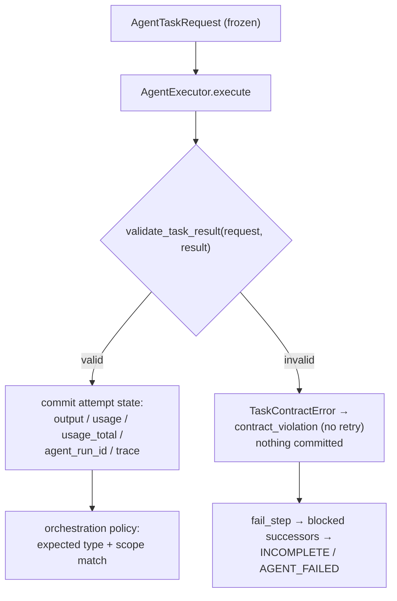
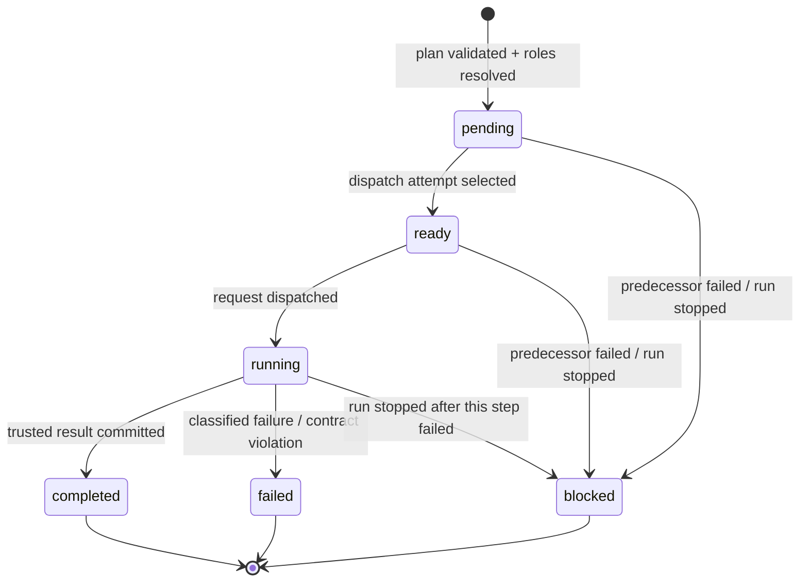
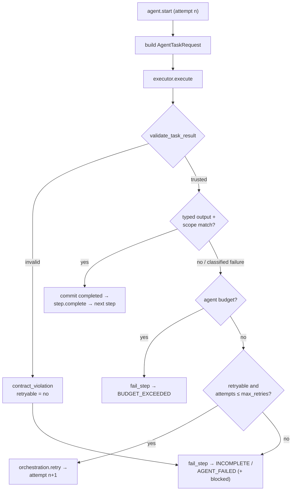

# M19 — Contract-Driven Agent Coordinator

Status: implemented (offline suite green, demonstration exit 0).
M19.1: hardening pass — result validation at the coordinator
boundary, result-owned trace attribution, honest cumulative usage,
sequential-dispatch tests, diagrams.
Scope: `src/repo_intelligence/orchestration/` (new modules +
`runner.py` refactor), `agentrun_m19_orchestrator_agents_demo.py`.

---

## 1. Why M19 exists

M17 proved that a plan, two agents, explicit bounds, and one sealed
terminal state belong to the application, not the model. But the
step loop still *reached into* its participants: it read
`agent.last_trace`, counted tool calls by diffing traces, classified
exceptions with private helpers, and merged reports from inside the
runner. Every new participant type (the post-M17 specialists) would
have meant more of the same.

M19 turns that inside out. The orchestrator becomes a COORDINATOR
over an explicit, typed task boundary:

* one immutable request (`AgentTaskRequest`) describes a unit of
  work — identity, role, scope, dependencies, prompt, budget;
* one port (`AgentExecutor.execute`) runs it and returns one
  immutable result (`AgentTaskResult`) with a typed output, this
  call's trace, measured usage, and — on failure — a structured
  `TaskFailure` classified exactly once;
* one record (`TaskRecord`) per plan step holds authoritative
  orchestration state, mutated ONLY by the coordinator;
* readiness (`scheduling.py`) and assembly (`assembly.py`) are pure
  functions the coordinator calls — not code buried in the loop.

The observable behaviour of M17 (events, statuses, budgets, retries,
termination reasons, validation) is preserved byte-for-byte; what
changed is WHERE the seams are.

## 2. What M19 does / does not do

Does:

* define the task contracts, the executor port + default adapter,
  the readiness helpers, and the explicit assembly step;
* dispatch every step through the port (default adapter = the two
  injected agents; callers may inject any executor);
* validate EVERY returned `AgentTaskResult` against its request
  before committing anything (`validate_task_result` — M19.1); an
  invalid result fails the task with `contract_violation` and
  contributes no state;
* commit `TaskRecord` state (status, attempts, failure category,
  usage/usage_total, trace id, output) from trusted
  `AgentTaskResult`s only;
* centralize failure classification in `contracts.classify_exception`
  — the exact predicates the M17 loop used, now in one place.

Does NOT (unchanged boundary):

* no parallel execution, no DAG scheduler, no broker, no
  LangGraph/CrewAI/AutoGen, no second agent framework;
* no new event vocabulary (`ORCHESTRATION_OPERATIONS` is unchanged —
  task lifecycle is surfaced through `run.tasks`, not new events);
* no new validation rules, no new evidence model, no fabricated
  token accounting (tokens stay `None` unless the provider reported
  them — `combine_usage` sums only reported values);
* no per-task tool budget AT M19 TIME: `AgentTaskRequest.
  max_tool_calls` was RESERVED (carried for visibility, never
  enforced at the boundary). Enforcement stayed where it was — the
  participant's agent-level `AgentExecutionConfig.max_tool_calls`
  and the orchestrator's `OrchestrationConfig.max_total_tool_calls`
  (no overlapping budget systems; pinned by test, not just
  documented). **M20 completed the contract**: the request field is
  now an enforced per-attempt limit at the real pre-tool guard
  (executed tool results), the runner's config gained
  `max_task_tool_calls` as the request-level default, and the run
  gate is between-attempt only — see
  [m20-orchestrator-contract-completion.md](m20-orchestrator-contract-completion.md).

## 3. The task boundary — `orchestration/contracts.py`

The contracts module is the BOTTOM of the package import graph (it
imports nothing from the package except stdlib + `AgentError` /
LLM error predicates), so `models.py` can import its vocabulary
without a cycle.

### `AgentTaskRequest` (frozen)

| field | meaning |
|---|---|
| `run_id`, `task_id`, `attempt` | correlation identity |
| `role`, `assignment_reason` | who and why (roles from `roles.py`) |
| `question`, `goal`, `prompt` | task-scoped envelope (prompt never logged) |
| `repository_scope`, `commit_scope` | scope travels with the task |
| `depends_on` | validated dependency ids |
| `dependency_results` | ONLY the dependency results allowed as input (the merged report for the analyst) |
| `max_tool_calls` | RESERVED at M19 — visibility only, `None` normally; never enforced here (agent-level config enforces; test-pinned). **M20:** enforced per-attempt limit at the pre-tool guard; runner sets it from `OrchestrationConfig.max_task_tool_calls` |

`summary()` returns metadata ONLY (no prompt, no question text) —
safe for logs, events, and timelines.

### `AgentTaskResult` (frozen)

`status` uses the `TASK_*` vocabulary; `output` is the participant's
typed payload (never an unvalidated dict); `failure` is a
`TaskFailure` when status is failed; `usage` is a `TaskUsage`;
`evidence_refs` is extracted at the boundary; `agent_run_id` +
`trace` are THIS execution's (the adapter only reports a trace that
appeared during this call — never a previous `last_trace`).

### Result validation — `validate_task_result` (M19.1)

A returned result is NEVER trusted before commit. The runner calls
`validate_task_result(request, result)` (coordinator side, same
module) immediately after `executor.execute`; the first violation
raises `TaskContractError`:

| rejected shape | why |
|---|---|
| not an `AgentTaskResult` | boundary type |
| `run_id`/`task_id`/`attempt`/`role` ≠ the request | correlation must echo; results never re-label dispatches |
| `usage` not `TaskUsage`, `evidence_refs` not tuple | declared annotation types |
| status ∉ {`completed`, `failed`} | `incomplete`/`cancelled` are coordinator-side RECORD states — an executor may never invent them |
| `completed` + `failure`, or `completed` + free-form `dict` output | the contract requires a typed payload (whether it is the EXPECTED type stays orchestration policy) |
| `failed` without `TaskFailure`, or `failed` + `output` | failures carry classification, never payloads |

`completed` + `output=None` is deliberately allowed: the runner
classifies it as its retryable `MISSING_STRUCTURED_OUTPUT` (its own
policy, unchanged). A violation becomes
`FAILURE_CONTRACT_VIOLATION` (category `contract_violation`,
`retryable=False`): the task fails once, nothing from the result
(output, usage, trace, correlation id) is committed, successors are
blocked, run terminates `INCOMPLETE` (investigator step) or
`AGENT_FAILED` (analyst step).



### `TaskFailure` (frozen) — the one taxonomy

`category` + `error_type` + `error_message` + `retryable` +
`termination_reason`. `classify_exception(exc)` maps:

| exception | category | retryable |
|---|---|---|
| `AgentError` / `EXECUTION_LIMIT_REACHED` | `agent_execution_budget` | no |
| `AgentError` / `FINALIZATION_FAILED` | `finalization_failed` | no |
| `is_context_length_error(exc)` | `context_exhausted` | no |
| `LLMError` (transient) | `provider` | yes |
| `StructuredOutputValidationError` | `structured_output` | yes |
| `AgentError` / `TOOL_DISPATCH_ERROR` | `dispatch_error` | yes |
| `AgentError` / `INVALID_LLM_RESPONSE` | `invalid_response` | yes |
| anything else | `unexpected` | yes |

One extra category exists that `classify_exception` never produces:
`contract_violation` — assigned by the runner when
`validate_task_result` rejects a result (implementation bug at the
boundary, never retryable).

The predicates are copied from M17's loop verbatim — classification
is behavior-preserving, not a re-interpretation. The retry loop now
asks `failure.retryable`; it no longer decides anything itself.

### `TaskUsage` (frozen) — honest accounting only

`tool_calls` + `model_iterations` counted from the trace,
`elapsed_seconds` measured by the executor's own clock, token fields
summed from provider-reported per-iteration usage metadata and
`None` when none was reported. Never estimated, never invented.

`combine_usage(*usages)` is the ONE summation rule (M19.1):
counters and elapsed time always sum; token fields sum only the
attempts that REPORTED them and stay `None` when none did — a
missing measurement never becomes a fabricated `0`. The coordinator
applies it to `TaskRecord.usage_total` (all attempts of one task;
`TaskRecord.usage` stays the MOST RECENT attempt) and
`OrchestrationRun.usage_total` (all committed attempts of the run —
budgets keep using the existing `tool_calls_total`).

## 4. The executor port — `orchestration/executor.py`

* `AgentExecutor` (Protocol) — `execute(request) -> result`. The
  orchestrator's ONLY way to run a participant.
* `ParticipantRegistry` — explicit role → participant map; selection
  never falls back (unknown role raises `ValueError` naming the
  known roles); duplicate/empty/`None` registrations rejected.
* `AgentTaskExecutor` — the default adapter for any run_result-style
  participant:
  * snapshots `participant.last_trace` before the call and reports
    only a fresh trace afterwards (attribution is per call);
  * success → `TASK_COMPLETED` with typed `structured_output`
    (or `None` — the coordinator decides what that means against its
    expected type);
  * exception → `TASK_FAILED` with `classify_exception(exc)` —
    returned, never raised (only boundary misuse raises: a
    non-request argument, an unknown role);
  * `for_agents(investigator, analyst)` builds the M17-compatible
    adapter with its OWN monotonic clock (the orchestrator's clock
    is for run budgets and is not threaded through).

Specialists work through the same boundary unchanged: any object
with `run_result(question)` returning something with
`structured_output` (and optionally `last_trace`) is a valid
participant — the specialist contracts (`ArchitectureReport`,
`FlowDependencyReport`, `DiagramSpec`) arrive as typed `output`.

## 5. Scheduling — readiness, not a scheduler — `orchestration/scheduling.py`

Two pure functions, testable without running anything:

* `sequential_dependencies(task_ids)` — the ONE place plan list
  order becomes dependency edges (each task depends on its
  predecessor). Readiness and plan order remain separable concepts.
* `ready_tasks(tasks, completed_ids=None)` — pending/ready tasks
  whose dependencies are all completed, in plan order. A task marked
  completed (by record status or by the `completed_ids` override)
  is never re-offered; a pending task with a failed dependency is
  not ready.

The M19 dispatch policy stays sequential (application-owned): the
loop still walks plan order, but now gates each dispatch on
`ready_tasks` (a not-ready task raises loudly rather than running)
and reuses the chain mapping for `depends_on` on every record and
request. Parallel dispatch is a future policy change against the
same interface — not this milestone. Sequentiality is test-pinned at
the runner level too (`test_m19_sequential_dispatch.py`): request
order, `run.agent_runs`, and event sequences all show P1 completed
BEFORE P2 started, and the successor's `dependency_results` is
exactly the merged report.

## 6. `TaskRecord` — authoritative orchestration state — `models.py`

One record per plan step, created after plan validation + role
resolution:

```
task_id, role, status, depends_on, assignment_reason,
attempts, agent_run_id, output, evidence_refs,
usage, usage_total, failure_category, error,
started_at, completed_at
```

`usage` is the most recent attempt's measurement; `usage_total`
sums every committed attempt via `combine_usage` (retry-honest).
Status uses `TASK_*`:



(`incomplete`/`cancelled` remain reserved RECORD vocabulary —
`incomplete` never appears as a result status; `validate_task_result`
rejects it there.)

Single-source-of-truth rule: `TaskRecord` is authoritative for task
state; `StepResult` stays the M17 typed-result projection and
`PlanStep.status` the plan-lifecycle projection — all three written
by the same coordinator commit path, so they can never disagree.
The participants never touch any of them (an injected executor's
results are committed exactly like the default adapter's).

`OrchestrationRun.tasks` is additive — every existing field, event,
and projection is untouched. `OrchestrationRun.usage_total` (M19.1,
additive) is the run-level sum over committed attempts.

## 7. Runner integration — what changed in `runner.py`

* `Orchestrator.__init__` gained an optional `executor:` param
  (default `AgentTaskExecutor.for_agents(investigator, analyst)`);
  `orchestrator.executor` exposes it.
* the retry loop now: records `agent.start` → marks the record
  `running` → builds the `AgentTaskRequest` (scope, chain
  `depends_on`, `dependency_results = (run.report,)` for the
  analyst) → `executor.execute(request)` → **validates the result
  against the request first** (M19.1) → commits
  attempts/usage/usage_total/agent_run_id ONLY from a trusted
  result → runs the SAME output checks (expected type, scope match)
  → records `agent.complete` with the same fields as before.



* failure handling reads `result.failure.category` /
  `result.failure.retryable`: `agent_execution_budget` still fails
  the step immediately and terminates `BUDGET_EXCEEDED`; the two
  coordinator-fabricated failures keep their exact strings
  (`SCOPE_MISMATCH: ...`, `MISSING_STRUCTURED_OUTPUT: expected …`)
  and their `scope_mismatch` / `structured_output` categories
  (retryable, as before); `contract_violation` fails the step
  immediately (never retried, no result state committed).
* the private helpers `_trace_run_id`, `_count_tool_calls`,
  `_failure_reason`, `_is_agent_budget_error`,
  `_is_execution_boundary_error` are gone — the executor owns
  attribution and classification now.
* trace attribution (M19.1): step-window events mirror onto
  **`result.trace`** — the boundary's own attribution — and are
  written through the sink; the orchestrator never reads a
  participant's `last_trace` (an injected executor's participants may
  never run, may expose a stale trace, or the result may carry an
  untrusted trace after a contract violation — none of it is
  mirrored; `trace=None` just closes the window and the run's event
  list stays authoritative).
* evidence: `investigator_traces` is fed from `result.trace` (every
  attempt with a fresh, trusted trace still counts — same
  semantics); `analyst_trace = result.trace`.
* `merge_investigation_reports` moved VERBATIM to `assembly.py`
  (still re-exported from `runner` and the package); the loop's
  `ensure_merged()` and the final step use `RunAssembler`
  (`collect_investigator_reports` → `merge_reports` → `assemble`
  pairing the report with the finding).
* `_block_remaining` also commits `blocked` records (status + reason).
* events: NOTHING changed — the same 19 `orchestration.*`
  operations, same fields, same ordering (enforced by the existing
  vocabulary tests; task lifecycle surfaces via `run.tasks`, not new
  events).

## 8. Assembly — `orchestration/assembly.py`

* `merge_investigation_reports(reports, task)` — the M17 merge,
  relocated byte-for-byte (findings concatenated in step order,
  evidence refs de-duplicated by identity, open questions /
  uncertainties / sources unioned, status downgraded never upgraded,
  investigation id = first report's).
* `RunAssembler.collect_investigator_reports(step_results)` —
  completed investigator reports only.
* `RunAssembler.assemble(step_results, task, finding)` →
  `AssemblyOutcome(report, finding, has_analysis)` — the explicit
  final pairing; `NO_ANALYSIS` still keys off the absence of a
  finding, never off a fabricated one.

## 9. Demonstration — `agentrun_m19_orchestrator_agents_demo.py`

Offline and deterministic by default (scripted models, the REAL
dispatcher reading a real file; `--repository <root>` binds the
read-only tools through the seam; no `--live` — live runs go through
`agentrun_repository_query.py --live`). Seven phases, one story:

1. **contract** — one `AgentTaskRequest`: summary only (prompt text
   never printed), chain dependencies from `sequential_dependencies`.
2. **dispatch** — ONE execution through `AgentTaskExecutor`: typed
   output, trace id present, `1 tool call, 2 model iterations`,
   tokens reported as `None`.
3. **coordinated** — full `Orchestrator.execute` over a three-step
   plan: a `TaskRecord` per step, chain `deps`, terminal
   `COMPLETED / SUCCESS`, verdict 8/8.
4. **readiness** — pure `ready_tasks` snapshots:
   `['P1'] → ['P2'] → ['P3'] → []`.
5. **failure** — a contract-rejected payload: classified
   `structured_output`, retried to the bound (`retries: 1`), then
   `failed`; successors `blocked` with `P1_FAILED`; analyst never
   ran; terminal `INCOMPLETE / AGENT_FAILED`.
6. **recovery** — the SAME transient failure under the same bound:
   attempt 1 rejected, attempt 2 commits (`attempts: 2`,
   `retries: 1`, recent 2 vs cumulative 3 model iterations), the
   rest of the plan completes, terminal `COMPLETED / SUCCESS`.
7. **assembly** — merged report (2 findings, 1 de-duplicated ref),
   matching investigation id, verdict `passed`.

Exit codes: `0` all conditions held, `1` a condition failed,
`6` configuration/execution failure (unreadable evidence file,
scripted model over-invoked, participant raised).

## 10. Testing

```bash
# M19 focus (contracts, executor, scheduling, assembly, records,
# validation, trace attribution, usage, sequential dispatch, demo)
venv312/bin/python -m pytest tests/orchestration/test_m19_*.py -q
#   → 103 passed

# orchestration package
venv312/bin/python -m pytest tests/orchestration/ -q
#   → 222 passed

# full suite — baseline 2152 + 103
venv312/bin/python -m pytest tests/ -q
#   → 2255 passed, 2 skipped

# demonstration (offline, deterministic; default + fixture mode)
venv312/bin/python agentrun_m19_orchestrator_agents_demo.py   # exit 0
```

Test files:

| file | pins |
|---|---|
| `test_m19_contracts.py` | frozen dataclasses, summary never leaks prompt/question, full classification table, usage honesty |
| `test_m19_executor.py` | dispatch by role, typed output/trace/usage, exception → classified result, per-call trace attribution, specialist through the same boundary, registry rejection |
| `test_m19_scheduling.py` | chain derivation, readiness order, failed-dependency blocks, `completed_ids` purity |
| `test_m19_assembly.py` | three-home re-export, merge semantics unchanged, collect/assemble pairing |
| `test_m19_runner_tasks.py` | records committed per lifecycle (completed/failed/blocked/budget/scope), injected executor receives typed requests while agents stay idle, no-retry on non-retryable |
| `test_m19_result_validation.py` (M19.1) | `validate_task_result` rules (correlation, types, reserved statuses, flag/output combos), runner fails on violations with `contract_violation` committing NOTHING, no retry |
| `test_m19_trace_attribution.py` (M19.1) | events mirror onto `result.trace` (sink write included), participant `last_trace` never touched, untrusted/bare traces handled, run log authoritative |
| `test_m19_usage_semantics.py` (M19.1) | `combine_usage` honesty, retry cumulative vs most-recent `usage`, run-level totals; `max_tool_calls` reserved AT M19 (M20 rewrote these two tests: runner sets `OrchestrationConfig.max_task_tool_calls` onto every request, None keeps the agent's own budget) |
| `test_m19_sequential_dispatch.py` (M19.1) | plan-order requests, event sequences prove no overlap, successor gets exactly the merged report |
| `test_m19_demo.py` | seven phases, byte-determinism, main exit codes (0/0/6), no f-strings, no second framework |

## 11. Risks and implementation notes

* **Constructor vs. execute** — the executor is injected on
  `Orchestrator(...)`, not `execute(...)`: the coordinator's port is
  part of its construction (like the participants themselves), and
  `execute`'s signature stays backward compatible.
* **Clocks** — the default adapter keeps its OWN monotonic clock;
  threading the orchestrator's clock in would change wall-clock
  budget tests and couple the boundary back to the run.
* **Retry classification moved** — `failure.retryable` is decided in
  `classify_exception`; the loop's two fabricated failures stay
  retryable locally (scope mismatch re-reads the same input safely;
  missing output is a contract gap a retry can fix).
* **`last_trace` snapshots** — the adapter still snapshots
  `participant.last_trace` because run_result-style participants are
  stateful between calls; the adapter, not the orchestrator, owns
  that knowledge now.
* **Unreachable readiness gate** — under the sequential chain the
  gate always passes; it raises loudly instead of ever running a
  not-ready task (defensive, like the missing-report `RuntimeError`).
* **Event vocabulary frozen** — task lifecycle deliberately does NOT
  add events; `run.tasks` is the additive, typed surface (existing
  `ORCHESTRATION_OPERATIONS` tests would otherwise need churn).
* **Validation runs before ANY commit** — the runner touches
  `result.output/usage/trace/agent_run_id` only after
  `validate_task_result` passes; a non-`AgentTaskResult` return can
  therefore never crash the commit path (it fails as a contract
  violation like any other).
* **Trace attribution moved from participant to result** — the M17
  mirroring tests stay green unchanged because for the default
  adapter `result.trace` IS the fresh participant trace; only
  injected executors observe the difference (their participants'
  `last_trace` is now irrelevant to the runner).
* **Scripted test executors must echo correlation** — `run_id` is
  generated per run (unknowable when a script is built), so test
  doubles echo `request.run_id` via `dataclasses.replace`;
  `task_id`/`attempt`/`role` stay scripted and are asserted by the
  validator.

## 12. Limitations and deferred work

* Dispatch is still strictly sequential (one task at a time) —
  parallel/worker policies are deferred until a real consumer needs
  them; the port and readiness functions are the groundwork.
* `dependency_results` currently carries only the merged report for
  the analyst; finer-grained dependency payloads wait for a consumer.
* `TASK_INCOMPLETE` / `TASK_CANCELLED` are reserved RECORD vocabulary:
  `validate_task_result` actively REJECTS them as result statuses an
  executor may return (an executor may not invent outcomes);
  incomplete investigations surface as `failed` with their category,
  matching M17's `StepResult` semantics.
* `AgentTaskRequest.max_tool_calls` was reserved at M19: no
  task-scoped enforcement existed (the agent-level config was the
  one tool budget — deliberately not half-enforced anywhere).
  **M20 closed this gap**: the field is now an enforced per-attempt
  limit at the pre-tool guard, the runner sets it from
  `OrchestrationConfig.max_task_tool_calls`, and run-level budget
  checks stay between-attempt only —
  [m20-orchestrator-contract-completion.md](m20-orchestrator-contract-completion.md).
* Live-mode verification is not possible in this environment (no
  `OPENAI_API_KEY`); the coordinator runs on the offline path only
  here, exactly like the rest of the verification baseline.

## 13. Definition of done

1. Contracts immutable, prompt-safe summaries, one classification
   table — `test_m19_contracts.py` ✓
2. Executor port + default adapter + registry rejection —
   `test_m19_executor.py` ✓
3. Pure readiness/dependency functions — `test_m19_scheduling.py` ✓
4. Merge relocated unchanged, assembly explicit —
   `test_m19_assembly.py` ✓
5. `TaskRecord` lifecycle committed only by the coordinator,
   injected executor accepted — `test_m19_runner_tasks.py` ✓
6. Package exports (`__all__`) complete and sorted ✓
7. Demonstration offline, deterministic, exit 0 (fixture mode too,
   exit 6 on missing target) — `test_m19_demo.py` ✓
8. Full suite green: 2255 passed, 2 skipped (M19 baseline 2221 + 34
   M19.1 tests) ✓
9. Offline CLI end-to-end unchanged: exit 0 ✓
10. No new dependencies, no f-strings in demo/src, lines ≤79 in
    `src/`, protected files untouched ✓
11. Documentation: this file, `README.md` (M19 paragraph +
    milestone line), `AGENTS.md` (baseline + files + work log) ✓

M19.1 hardening:

12. Every `AgentTaskResult` validated against its request before any
    commit; `contract_violation` non-retryable, zero result state —
    `test_m19_result_validation.py` ✓
13. Step events mirror onto `result.trace` (sink-written), never a
    participant `last_trace`, never an untrusted trace —
    `test_m19_trace_attribution.py` ✓
14. Honest cumulative usage (`combine_usage`, `usage_total` at task
    and run level; `usage` stays most-recent) and `max_tool_calls`
    documented + test-pinned as reserved AT M19 (M20 replaced the
    reserved semantics with enforcement —
    `test_m19_usage_semantics.py` + `test_m20_task_budget.py`) ✓
15. Sequential dispatch test-pinned at the runner level;
    three Mermaid diagrams (boundary, task lifecycle, retry decision)
    in this document; demo gained the deterministic **recovery**
    phase (seven total) — `test_m19_sequential_dispatch.py`,
    `test_m19_demo.py` ✓
