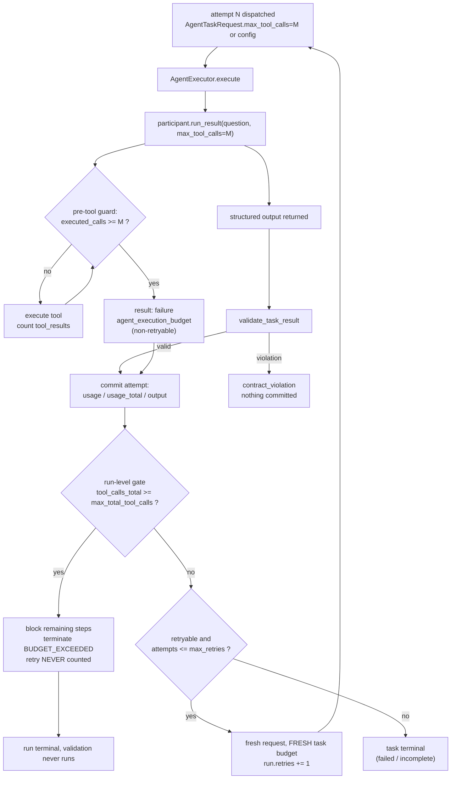

# M20 — Orchestrator Contract Completion and Task-Budget
# Enforcement

**Status:** complete (2026-10-16). Offline suite: **2307 passed, 2
skipped**. `tests/orchestration/` = 267. `test_m20_*.py` = 45.
`tests/agent/test_agent_bounded.py` = 22 (7 new M20 tests: 3 + a
4-case parametrize).

M19 closed the task boundary (typed request/result, result
validation, usage accounting). M20 completes the contract:

1. `AgentTaskRequest.max_tool_calls` becomes an **enforced
   per-attempt tool budget** at the real pre-tool guard (the same
   place the agent-level budget already counts — executed tool
   results, never requested/blocked calls);
2. `validate_task_result` hardens from declared-annotation checks
   to **runtime value checks** on `TaskUsage` and `TaskFailure`
   (a malformed result can never raise an incidental
   `AttributeError`/`TypeError` inside validation or arithmetic);
3. the orchestrator's run-level budget stays honest — checked
   **between attempts** (never mid-attempt, never counted as
   blocked calls), a budget termination is never overwritten by a
   later validation status;
4. dispatch stays sequential, report merge stays plan-order, and
   the event vocabulary is unchanged.

No LangGraph, no parallelism, no DAG scheduler, no new framework,
no new dependencies.

---

## 1. What changed (code map)

| file | change |
|---|---|
| `agent/agent.py` | `run_result(question, *, max_tool_calls=None)` — validated, per-call frozen config via `dataclasses.replace` (no shared mutation), threaded as `execution_config` through `_run_loop` → `_execute_loop` → `_finalize_run`; used for `AgentTrace.start` and every in-loop budget read |
| `agents/architecture_investigator.py` | `run_result(..., max_tool_calls=None)` pass-through (None → byte-identical M19 call) |
| `agents/flow_dependency_investigator.py` | same pass-through |
| `agents/architecture_visualization.py` | same pass-through |
| `orchestration/contracts.py` | `AgentTaskRequest.__post_init__` validates `max_tool_calls` (None \| int ≥ 0, bool rejected); `OrchestrationConfig.max_task_tool_calls` (new field); `_validate_task_usage` + `_validate_task_failure` (new runtime value rules); hardened `validate_task_result`; field comment no longer "RESERVED" |
| `orchestration/executor.py` | passes `max_tool_calls=` to the participant ONLY when the request set it (None path byte-identical M19 call; a participant that rejects the kwarg raises loudly = boundary misuse); `_count_tool_calls` now sums **executed** `tool_results` (blocked/requested calls never counted — M19 defect fixed) |
| `orchestration/runner.py` | request carries `max_tool_calls=self._config.max_task_tool_calls`; `validate_task_result` wrapped (`TaskContractError` AND any unexpected exception → same `contract_violation` path, never leaks out of `execute()`); budget event fields populated (`limit`/`observed`); **per-attempt gate at the retry decision point** — before `run.retries += 1`, so a blocked retry never counts |
| `orchestration/models.py` | no changes (budgets ride existing fields/events) |
| `orchestration/assembly.py` | no changes (plan-order merge already correct; now test-proven with a 2-investigator plan) |

## 2. Per-attempt tool budget — semantics

Three budgets, deliberately non-overlapping:

| budget | scope | check point | zero means |
|---|---|---|---|
| `AgentExecutionConfig.max_tool_calls` | one agent run (one attempt) | pre-tool guard inside `_execute_loop` (counts EXECUTED calls) | task fails `EXECUTION_LIMIT_REACHED` |
| `AgentTaskRequest.max_tool_calls` | one attempt (one dispatch) | same pre-tool guard, override for THIS call only | result carries `agent_execution_budget` failure |
| `OrchestrationConfig.max_total_tool_calls` | one orchestrator run | between attempts (`_pre_step_gate`, retry decision) | run terminates `BUDGET_EXCEEDED` |

Documented rules (test-pinned in
`tests/orchestration/test_m20_task_budget.py`):

* **task limit = one attempt**: the request's `max_tool_calls`
  bounds the single dispatch it describes; a retry is a NEW request
  with a FRESH allowance (cumulative usage still sums all attempts);
* **the task limit never leaks**: the participant's configured
  `AgentExecutionConfig` is untouched after a per-call override
  (verified by running the same agent again — it returns to its own
  budget);
* **the run-level cap is between-attempt only**: a started attempt
  may finish its remainder (the guard cannot cancel a mid-attempt
  tool batch); the next attempt never starts;
* **blocked calls are never counted**: the executor counts
  `tool_results` (executed), not `tool_calls` (requested). An
  over-budget call that the guard blocks never inflates usage;
* **`max_tool_calls=0`** is meaningful: the agent runs zero tool
  calls and the task fails cleanly at the boundary (executor path)
  or `EXECUTION_LIMIT_REACHED` (orchestrator zero-budget path);
* **budget event fields**: `budget="agent_max_tool_calls"` now
  carries `limit=request.max_tool_calls` and
  `observed=task_record.usage.tool_calls` (the M17 event name is
  unchanged; the two fields were previously absent/None).

The retry-decision gate placement is deliberate: the check runs
INSIDE `if retryable and attempts <= max_retries:` BEFORE
`run.retries += 1`. A run-level stop therefore never counts as a
consumed retry, never marks the current step failed (it blocks it
with the gate's reason), and never reaches validation.



## 3. `validate_task_result` hardening

M19.1 checked declared annotation types and correlation fields. M20
adds RUNTIME VALUE rules — the dataclass constructors do not
guarantee them (`frozen=True` + annotations do not stop
`object.__setattr__`, hostile executors, or hand-built results):

| new rejection | rule |
|---|---|
| `TaskUsage.tool_calls` / `model_iterations` | non-negative `int`, bool rejected |
| `TaskUsage.elapsed_seconds` | finite `float` ≥ 0 (NaN/inf rejected via `math.isfinite`), bool rejected |
| `TaskUsage.input_tokens` / `output_tokens` / `total_tokens` | `None` or non-negative `int` (unreported stays `None`; never fabricated 0) |
| `TaskFailure` (on BOTH completed+failure and failed paths) | must be a `TaskFailure` instance BEFORE any field is read (a str/dict/object raises `TaskContractError`, never `AttributeError` from `.category`) |
| `TaskFailure.category` / `error_type` / `error_message` | `str` |
| `TaskFailure.retryable` | `bool` |
| `TaskFailure.termination_reason` | `None` or `str` |
| `AgentTaskResult.agent_run_id` | `None` or `str` |

Every violation is the established non-retryable
`FAILURE_CONTRACT_VIOLATION`: the task fails once, NOTHING commits
(output/usage/trace/agent_run_id/tool calls), successors block, run
terminates. The runner additionally catches ANY exception escaping
the validator (models a validator bug or hostile result whose
attribute access explodes) and routes it through the same
`contract_violation` path — `execute()` never leaks an incidental
exception. A VALID failed attempt's measured usage still commits
exactly once (only malformed data is excluded; honest accounting is
preserved).

```mermaid
sequenceDiagram
    participant O as Orchestrator
    participant E as AgentExecutor
    participant P as Participant
    participant V as validate_task_result
    O->>E: execute(AgentTaskRequest)
    E->>P: run_result(question, max_tool_calls=M)
    P-->>E: AgentTaskResult(status, output, usage, trace)
    E-->>O: result
    O->>V: validate_task_result(request, result)
    alt valid
        V-->>O: None
        O->>O: commit attempt (trusted)
    elif TaskContractError
        V-->>O: raise
        O->>O: failure=contract_violation, commit NOTHING
    elif unexpected Exception (bomb usage / validator bug)
        V-->>O: raise (any)
        O->>O: same contract_violation path (except Exception)
    end
    O->>O: run-level gate → retry or terminal
```

## 4. Compatibility

* **M19 demo** byte-identical phases (default + `--repository`),
  exit 0; **M17 demo** exit 0; offline CLI exit 0 / COMPLETED.
* `execute(task, plan, role_overrides|role_assignments)` signature
  unchanged (M17 preassigned roles preserved).
* All M19/M19.1 tests retained with one honest update: the two
  "reserved max_tool_calls" tests in `test_m19_usage_semantics.py`
  were rewritten to the M20 semantics (runner sets the config
  default onto every request; None keeps the agent's configured
  budget). The M19 executor test double gained the real
  `tool_results` trace shape (one executed call → `tool_calls == 1`,
  same assertion).
* One-argument `run_result(question)` calls (CLI, M16 agents,
  repository_query, tests) are byte-identical M19 behavior.
* Event vocabulary `ORCHESTRATION_OPERATIONS` unchanged; the budget
  event's `limit`/`observed` fields are additive (M17 tests pin
  `budget="agent_max_tool_calls"` by name and still pass).
* Exit codes unchanged (0 / 1 / 6 demo; 0 / 1 / 3 CLI).

## 5. Tests

Commands (all offline, `venv312/bin/python`):

```bash
venv312/bin/python -m pytest tests/orchestration/ -q        # 267 passed
venv312/bin/python -m pytest tests/agent/test_agent_bounded.py -q  # 22 passed
venv312/bin/python -m pytest tests/ -q                      # 2307 passed, 2 skipped
venv312/bin/python agentrun_m19_orchestrator_agents_demo.py # exit 0 (7 phases)
venv312/bin/python agentrun_m17_orchestration_demo.py       # exit 0
venv312/bin/python agentrun_repository_query.py "How do the agents, tools, and MCP servers interact?" --verbose  # exit 0 COMPLETED
```

New M20 test files:

| file | pins |
|---|---|
| `test_m20_task_budget.py` (9) | executor pre-tool blocking, exactly-N, None path, kwarg-passing recorder, zero-through-orchestrator (BUDGET_EXCEEDED + event limit/observed 0), invalid values (bool/negative/str), fresh retry allowance (usage_total sums), no leak (agent stays at its own budget; trace shows 1), run-budget blocks retry (retries stays 0, gate blocks remaining steps, validation never runs) |
| `test_m20_result_validation.py` (33) | parametrized malformed usage values (negatives, bool-as-int, NaN/inf elapsed, float tokens), valid honest usage passes, failure-must-be-TaskFailure on both paths (str/42/object/dict), malformed failure field values, failed+valid-failure+measured-usage passes, agent_run_id type, runner integration (malformed usage commits nothing / no retry / successors blocked; `_BombUsage` property-raise → except-Exception contract_violation; valid failed attempt commits usage exactly once; dict output still violation; real report still passes) |
| `test_m20_lifecycle.py` (3) | 2-investigator plan: dispatch order P1→P2→P3 (never interleaved), merge order = plan order (first report keeps its investigation_id, findings concatenated in plan order); budget terminal status survives (validation never starts, no `orchestration.complete`); happy path still COMPLETED with validation passed |
| `test_agent_bounded.py` +7 | per-call override blocks before dispatch and does not leak; override allows exactly N; configured budget applies again after override; invalid values (negative / bool / float / str) rejected |

Workstream D/E checks retained from M19:
`test_m19_sequential_dispatch.py` (no second task starts while the
first executes), `test_m19_runner_tasks.py` (records, failure/block
semantics), `test_m19_executor.py` (boundary adapter), taxonomy
predicates unchanged (`classify_exception` tests).

## 6. Demonstration

No new demo file. M19's seven-phase demonstration remains the
coordinator showcase (contract → dispatch → coordinated records →
readiness → failure → recovery → assembly, byte-deterministic,
exit 0/1/6, `--repository` fixture mode). M20 budgets ride the same
events and records: the recovery phase's attempt-2 commit now
carries a populated `limit`/`observed` on any budget event. Live
runs go through `agentrun_repository_query.py --live` (requires
`OPENAI_API_KEY`, unavailable in this environment — offline mode is
the verification path).

## 7. Known limitations / deliberate non-goals

* **Run-level budget is between-attempt only**: a started attempt
  may execute the remainder of its tool batch before the next gate
  (mid-attempt cancellation would require a cooperative abort
  channel inside `_execute_loop` — out of scope, documented).
* **Per-step budgets not added**: only the run-level
  `max_total_tool_calls` and the per-attempt request override exist;
  a per-step allowance would touch plan construction (out of
  scope). Direct/custom-executor callers can set
  `AgentTaskRequest.max_tool_calls` themselves.
* **Tokens stay `None` unless reported**: M20 never fabricates
  token accounting (unchanged M19 honesty).
* **`_compact_working_context` still reads the shared
  `self._execution_config`**: compaction fields are unrelated to
  the budget; only budget/finalize reads were threaded.
* **No LangGraph/CrewAI/AutoGen**, no parallelism, no DAG scheduler,
  no new event operations, no new dependencies.

## 8. Future LangGraph boundary (handoff)

If a LangGraph (or any graph-runtime) coordinator is ever layered
on, M20 makes the seams explicit:

* the **task boundary** (`AgentTaskRequest` → `AgentExecutor` →
  `AgentTaskResult` → `validate_task_result`) is already a pure
  data contract with no framework imports — a graph node can call
  `executor.execute` directly;
* **budgets travel with the request** (`max_tool_calls`) and the
  config (`max_task_tool_calls` / `max_total_tool_calls`), so a
  graph runtime cannot accidentally drop enforcement: it must
  respect the same pre-tool guard (the participant enforces it
  internally — the graph cannot bypass it by skipping the runner);
* **sequential dispatch and plan-order merge** are pure functions
  (`ready_tasks`, `sequential_dependencies`,
  `RunAssembler.collect_investigator_reports`) — a graph edges
  builder can reuse them without re-implementing ordering;
* **result-owned trace attribution** and **honest cumulative
  usage** are boundary-level guarantees — a graph runtime that
  commits a result without calling `validate_task_result` forfeits
  them (documented here as the contract-violation risk).

The M19/M20 boundary is therefore graph-runtime-agnostic: no
LangGraph import exists and none is planned until a concrete graph
orchestration requirement appears.
