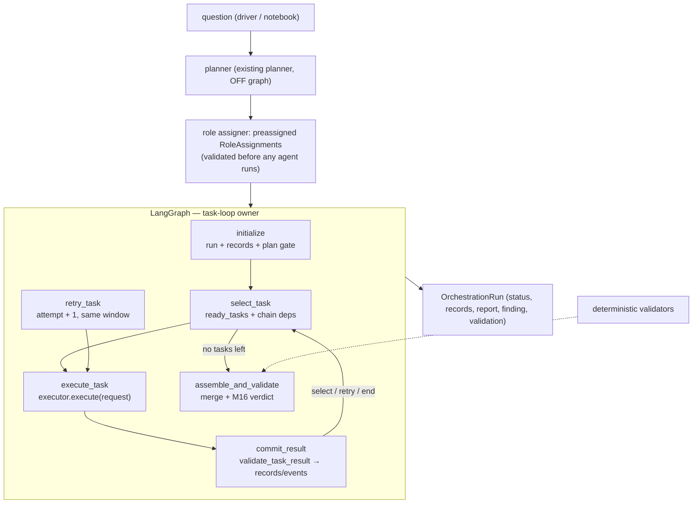

# M21 — LangGraph orchestration: dynamic task-level control flow

**Status:** implemented and verified (offline). **Date:** 2026-10-16.
**Interpreter:** `venv312/bin/python` (3.12.3), `langgraph==1.2.15`
(installed via `venv312/bin/python -m pip`; declared as the optional
`graph` extra in `pyproject.toml`, pinned in `requirements.txt`).

## 1. What this milestone is

LangGraph becomes the **source of truth for task-level sequential
orchestration control flow** — task selection, attempts, retries,
budget gates, blocking, termination, assembly, validation — over the
UNCHANGED M19/M20 contracts. The plan (task count, dependencies) is
data, not topology: one compiled graph runs 2-step and 4-step plans
(test-proven).

Non-goals (per brief): no parallelism/`Send`, no checkpointing, no
replanning, no competing planner models, no rewriting of the M17–M20
contracts, and **no `Orchestrator.execute(...)` on the graph path**
(enforced by test, §6).

## 2. Component and dataflow



The injected `Orchestrator` is used **only as a compatibility
runtime**: its executor (`AgentTaskExecutor`/injected executor),
config, clock, and small lifecycle helpers (`record_event`,
`close_trace_window`, `append_handoff`, `pre_task_gate`,
`_preassigned_role_assignments`, the question builders).
`runtime.execute` is never referenced.

## 3. State, nodes, transitions

State (`LangGraphOrchestrationState`, `total=False`): domain keys
(`task`, `plan`, `role_assignments`, `run`, `started`) + small routing
keys (`task_index`, `attempt`, `current_*`, `investigator_traces`,
`analyst_trace`, `current_window`, `terminal`, `routing`, …). The
`run` object is the authoritative domain record; in-place key writes
are discarded by LangGraph, so nodes RETURN their state changes —
shared mutable objects (`run`, task records, windows) persist by
reference (verified empirically on 1.2.15).

| Node | Responsibility | Exits (routing) |
|---|---|---|
| `initialize` | fresh `OrchestrationRun`, task records, preassigned-role validation (ValueError before anything runs), plan gate, first window | `select`, `end` (plan failed) |
| `select_task` | `ready_tasks` over pending records with chain dependencies (`sequential_dependencies`), budget gate before an attempt starts | `execute`, `assemble`, `end` |
| `execute_task` | one `AgentTaskRequest` → `runtime.executor.execute` | (unconditional) `commit_result` |
| `commit_result` | `validate_task_result`; on violation commit NOTHING and fail; success → commit output/usage/trace; failure → retry decision (`orchestration.retry` into the step window) or terminal `orchestration.step.failed` + `block_from` | `select`, `retry`, `end` |
| `retry_task` | fresh request with `attempt = state["attempt"]`, SAME per-step window, `agent.start` re-records | `execute` |
| `assemble_and_validate` | `RunAssembler` merge (plan order), `NO_ANALYSIS` gate, validation gate, M16 `validate_collaboration`, `DECLARED_INCOMPLETE` / `VALIDATION_FAILED` / `COMPLETED` | `END` |

Edges: `START → initialize`; conditional
`initialize → {select_task, END}`; conditional
`select_task → {execute_task, assemble_and_validate, END}`;
`execute_task → commit_result`; conditional
`commit_result → {select_task, retry_task, END}`;
`retry_task → execute_task`; `assemble_and_validate → END`.

Terminal states mirror the runner exactly: `COMPLETED/SUCCESS`,
`INCOMPLETE/{NO_ANALYSIS, DECLARED_INCOMPLETE, AGENT_FAILED}`,
`AGENT_FAILED/AGENT_FAILED`, `VALIDATION_FAILED`, `PLAN_FAILED`,
`BUDGET_EXCEEDED` (agent budget observed/limit event; run budget
checked at the retry decision so a budget stop never consumes a
retry), `TIMEOUT`.

## 4. What is reused unchanged (never forked)

- Contracts: `AgentTaskRequest`/`AgentTaskResult`, `TaskFailure` +
  `classify_exception`, `validate_task_result` (M19.1/M20 runtime
  value checks), `TaskUsage`/`combine_usage`, `TaskRecord`,
  `OrchestrationRun`, `StepResult`, status/role vocabularies.
- Scheduling: `sequential_dependencies` + `ready_tasks` (pure).
- Assembly: `RunAssembler` / `merge_investigation_reports`.
- Validation: `validate_collaboration` (M16) + plan validation.
- Dispatch: the same `AgentTaskExecutor` boundary — real specialists
  (`ArchitectureInvestigator`, `FlowDependencyInvestigator`,
  `ArchitectureVisualization`) reach the graph through `QueryRouter`
  (or direct agents); roles may be preassigned (`RoleAssignment`s
  validated before execution) or produced by the existing assigner.

## 5. Parity with `Orchestrator.execute` (runner rules preserved)

- One trace window per STEP across attempts; `orchestration.retry`
  records INTO the pending window; windows close via
  `close_trace_window` (drain, idempotent).
- Terminal failure records `orchestration.step.failed`
  (`status="AGENT_FAILED"`, `error=`) then closes the window —
  identical to `fail_step`.
- Failed `agent.complete` carries `reason = failure.error_type if
  failure is not None else error`.
- `block_from(index+1, "<STEP>_FAILED")` mirrors `_block_remaining`;
  plan-gate/validation-gate events and literals
  (`inprogress/completed/failed/blocked`) unchanged; event vocabulary
  is the M17 set only (no new operations — budget events keep their
  additive `limit`/`observed` fields).

**Defect fixed this milestone:** `terminate(...)`'s third parameter was
named `reason`, so the plan-failed and validation-failed branches
(`terminate(..., reason=str(exc))` — the runner's event field) raised
`TypeError: got multiple values for argument 'reason'` instead of
committing `VALIDATION_FAILED`/`PLAN_FAILED`. Renamed the parameter to
`termination_reason` (the runner's `_terminate` signature) so `reason`
flows as an event field. Found by the new behavioral tests — both
branches were previously unreachable from tests.

**Shared-layer defect (found by the failing notebook run):** the M20
per-attempt budget (`AgentTaskRequest.max_tool_calls`) is passed by the
executor as `run_result(question, max_tool_calls=...)` — a deliberate
"loud boundary" contract (`executor.py`). Two participant WRAPPERS in
`repository_query.py` had never been given that kwarg:
`QueryRouter.run_result(question)` and
`ObservedAgent.run_result(question)`. With the notebook's
`max_task_tool_calls=12`, the executor's call raised
`TypeError: ... got an unexpected keyword argument 'max_tool_calls'`
BEFORE any execution — classified `unexpected`/retryable, retried once,
then terminal `INCOMPLETE/AGENT_FAILED`: zero tool calls, no trace
(`agent_run_id=None`, correctly not fabricated), all downstream steps
blocked. Reproduced identically on BOTH orchestration paths (shared
layer, not the graph adapter); the CLI escaped it only because
`M17_ORCHESTRATION_CONFIG` leaves the budget `None`. Fix: both wrappers
accept `max_tool_calls=None` and FORWARD it verbatim (never dropped;
`None` keeps the exact pre-M20 one-argument call for legacy
participants; a participant that rejects a set budget still fails
loudly at the call).

## 6. Behavioral proof — `tests/orchestration/test_langgraph_sequential.py`

34 tests, deterministic (scripted `FakeLLMClient`s, replayed boundary
results, `_Recording` executor wrapper); `pytest.importorskip`
guards on `langgraph.graph`. Coverage vs the brief's scenarios:

| # | Scenario | Test |
|---|---|---|
| 1/6/21 | plan order, preassigned roles verbatim, terminal status/termination/records | `test_two_investigators_then_analyst_execute_in_plan_order`, `test_preassigned_roles_are_respected_verbatim`, `test_final_status_termination_and_records_follow_rules` |
| 2 | one compiled graph, dynamic task count (2- and 4-step) | `test_same_compiled_graph_handles_different_plan_sizes` |
| 3/4 | `QueryRouter` repeats one specialist / routes per goal (real `run_result` boundary) | `test_router_repeats_one_specialist_for_multiple_tasks`, `test_router_selected_specialist_is_the_one_invoked` |
| 5 | analyst receives the assembled (merged) investigator output | `test_analyst_receives_the_assembled_investigator_output` |
| 7 | invalid roles → ValueError before any execution (5 variants) | `test_invalid_role_assignments_raise_before_any_execution` |
| 8 | dependencies: chain semantics, request→result timeline, readiness helper | `test_dependencies_prevent_premature_execution` |
| 9 | failed prerequisite blocks dependents (`<STEP>_FAILED`) | `test_failed_prerequisite_blocks_dependent_tasks` |
| 10/12/17 | retry within limit + cumulative usage; no retry when non-retryable; exhaustion | `test_retryable_failure_retries_within_the_limit_with_cumulative_usage`, `test_non_retryable_failure_receives_no_retry`, `test_retry_exhaustion_produces_the_terminal_outcome` |
| 13/14 | correlation mismatch / missing output / dict output → contract & policy outcomes, nothing committed | `test_correlation_mismatch_is_rejected_and_never_committed`, `test_missing_structured_output_fails_by_existing_policy`, `test_free_form_dict_output_is_a_contract_violation` |
| 15/16 | per-attempt budget (zero limit, blocked≠executed); run budget blocks next attempt without consuming a retry | `test_per_attempt_task_budget_is_enforced_at_the_agent_guard`, `test_run_level_budget_blocks_an_attempt_before_it_starts` |
| 18 | trace ids belong to actual attempts; graph state carries traces; window sequences unique | `test_trace_ids_belong_to_the_actual_attempts` |
| 19/20 | missing analyst output never fabricates a finding; no-analyst plan → `NO_ANALYSIS`; declared-insufficient vs execution failure | `test_missing_analyst_output_never_fabricates_a_finding`, `test_plan_without_analyst_ends_no_analysis_not_success`, `test_declared_insufficient_evidence_is_distinguishable_from_execution` |
| 22 | graph never delegates to `Orchestrator.execute` (monkeypatch + source scan) | `test_graph_path_never_calls_monolithic_execute`, `test_langgraph_runner_source_has_no_monolithic_dispatch_call` |
| — | request carries scope/budget/attempt/assignment identity | `test_requests_carry_scope_budget_and_attempt_identity` |
| budget boundary | notebook-equivalent budgeted `QueryRouter` executes with trace + usage; same budgeted scenario compatible on BOTH paths | `test_budgeted_query_router_executes_through_the_graph`, `test_budgeted_router_scenario_is_compatible_across_both_paths` |
| tracing | failure AFTER execution start keeps trace/usage/diagnostics; retry keeps BOTH attempts' attribution (record = most recent); failure BEFORE any trace records an honest `None` id (never fabricated) | `test_terminal_failure_after_execution_start_keeps_trace`, `test_retry_preserves_earlier_attempt_trace_attribution`, `test_failure_before_trace_creation_has_no_fabricated_id` |

Wrapper-forwarding unit tests live next to their subjects:
`tests/agents/test_repository_query.py`
(`test_router_forwards_the_request_level_tool_budget`,
`test_observed_agent_forwards_the_request_level_tool_budget` — incl.
the loud-`TypeError` policy for participants that reject a set budget)
and `tests/agents/test_architecture_investigator.py`
(`test_specialist_forwards_the_budget_through_the_observer_chain`,
pinning `specialist → ObservedAgent → agent`).

Note on scripted success: validation (`evidence_valid`) requires
gathered evidence in the TRACES, so tests that must reach
`COMPLETED` use real scripted agents (m17 doubles); boundary-fake
tests cover failure paths where validation never runs.

## 7. Environment, dependency declaration, guard-test policy

- `langgraph==1.2.15` installed into `venv312`
  (`venv312/bin/pip` script is missing — use
  `venv312/bin/python -m pip`).
- Declared, not assumed: `pyproject.toml` optional extra
  `graph = ["langgraph>=1.0"]`; `requirements.txt` pin
  `langgraph==1.2.15`. Core `repo_intelligence` imports without
  langgraph; `langgraph_runner` raises a clear ImportError when the
  extra is absent (its own test skips).
- **Two guard-test policy updates (deliberate, documented):**
  `tests/llm/test_client_contract.py::PROVIDER_IMPORT_RE` no longer
  lists `langgraph` (it is an orchestration graph library, not a
  provider SDK — provider frameworks/SDKs remain banned everywhere);
  `tests/orchestration/test_m17_repository_agnostic.py` now uses two
  patterns — the full framework/broker ban everywhere EXCEPT
  `langgraph_runner.py` may import `langgraph` only (`crewai`,
  `autogen`, `sqlalchemy`, `redis`, `pika`, `celery`, `requests`,
  `httpx` remain banned everywhere, including the adapter).
- **Live end-to-end not runnable in this environment:** no
  `OPENAI_API_KEY`, no `.env` (confirmed 2026-10-16). Offline
  deterministic execution is the verification path; live runs remain
  the user's Windows environment as before.

## 8. Notebook

`src/repo_intelligence/langgraph/langgraph_orchestrator_integrated_M20.ipynb`
(26 cells, 12 code — all compile under `ast.parse`): planner → role
assigner → task payload → `build_langgraph_orchestration_graph(orchestrator)`
as ONE nested node → summarize → trace inspection. Cleanup this
milestone: removed the dead "routing preview"
(`result.get("agent_assignments")` — key never set; cell 16 states
routing is proven by execution, not preview) and added the
`Validation status:` line to the final summary. The notebook does not
call `Orchestrator.execute` and does not own orchestration logic in
cells.

## 9. Verification (2026-10-16, exact commands/counts)

```bash
venv312/bin/python -m pytest tests/orchestration/test_langgraph_sequential.py -q   # 34 passed
venv312/bin/python -m pytest tests/orchestration/ -q                               # 301 passed
venv312/bin/python -m pytest tests/agents/test_repository_query.py -q              # 51 passed
venv312/bin/python -m pytest tests/agents/test_architecture_investigator.py -q     # 30 passed
venv312/bin/python -m pytest tests/ -q                                             # 2344 passed, 2 skipped
venv312/bin/python -m pytest tests/agents/test_investigator_evidence_acceptance.py \
    tests/agent/test_agent_bounded.py -q                                           # 31 passed
venv312/bin/python agentrun_m19_orchestrator_agents_demo.py                        # exit 0
venv312/bin/python agentrun_m19_orchestrator_agents_demo.py --repository tests/fixtures/construction  # exit 0
venv312/bin/python agentrun_m17_orchestration_demo.py                              # exit 0
venv312/bin/python agentrun_repository_query.py "How do the agents, tools, and MCP servers interact?" --verbose
                                                                                    # exit 0, COMPLETED
```

Baselines: full suite 2307 → **2344 passed, 2 skipped** (+29 graph
tests, +3 boundary/tracing regressions, +2 wrapper unit tests, +1
specialist chain test); `tests/orchestration/` 267 → **301**.
Post-defect-fix runtime check: the observed four-step notebook
scenario (P1–P3 INVESTIGATOR, P4 ANALYST, router + budget 12) rerun
deterministically → **COMPLETED / SUCCESS**, all four tasks completed
with trace ids, 3 measured tool calls, validation `passed`. Graph
compiled and
invoked repeatedly on langgraph 1.2.15 (tests build it fresh each
run); deterministic multi-plan execution proven by the two-invoke
test (distinct run ids, no rebuild).

**Verdict: complete (offline).** The only unverified item is live
model execution through the graph, blocked by the missing API key —
documented, not claimed.

## 11. Amendment (2026-10-19) — production opt-in + primary notebook

M21 originally shipped the graph loop with **no production wiring**
(the CLI ran the legacy loop only) — the known gap recorded as F1 in
`docs/langgraph-migration-audit.md`. That gap is now closed by the
end-to-end milestone (`docs/langgraph-end-to-end.md`):

- `run_repository_query(..., orchestration="langgraph")` and CLI
  `--orchestration langgraph` execute the SAME task loop through
  `run_with_langgraph`; the default stays `legacy`, and a missing
  `graph` extra is a typed `ORCHESTRATION_UNAVAILABLE` structured
  failure — **never a silent fallback**. `Orchestrator.execute` is
  still never called on the graph path (now test-pinned at the
  production-entry level too).
- Roles are preassigned with the same `assign_roles` assigner the
  legacy executor uses internally; the planner stays off-graph behind
  the H1 preflight, shared verbatim by both backends.
- One primary notebook:
  `notebooks/langgraph_end_to_end_workflow.ipynb` (10 sections,
  17 offline code cells) walks the whole workflow on the real
  implementation — topology, execution, evidence, retry/failure
  demos, legacy-vs-graph parity, and the H1 planner-gate demo.
- Tests: `tests/agents/test_repository_query_langgraph.py` (11) +
  `tests/agents/test_langgraph_notebook.py` (4). Graph-path
  behavioural suite unchanged at 34.

This document remains the M21 module spec; the entry-point contract
and notebook live in `docs/langgraph-end-to-end.md`.
